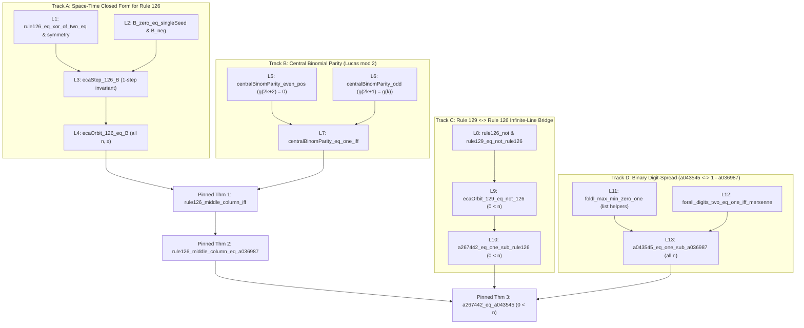
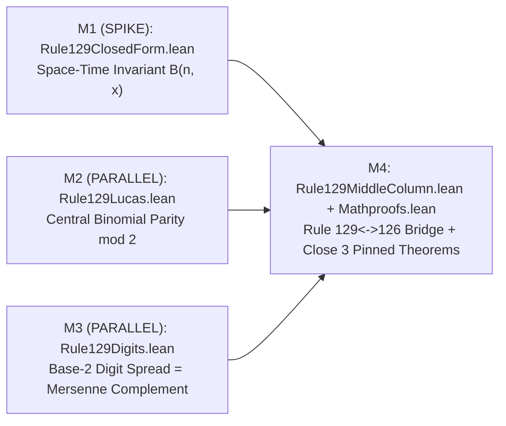

# Proof-Strategy Dossier — Rule 129 / Rule 126 Single-Seed Middle Columns (`a267442-eq-a043545`)

- **Lane:** `argon-rule129-proof-strategy-20261028`
- **Date:** 2026-10-29 UTC
- **Type:** Research & proof-architecture dossier only (zero code execution, zero repository edits, zero GitHub writes)
- **Target repository & freeze state:** `derekblair/math-proofs`, PR #16 merged `2026-10-29T05:56:22Z` at merge commit `437b890a32ede43ad1dfbc6ef0839e8d9ea16a7d` (freeze commit `3fc2503c69dba90dcf438be5c5334079c9c41266`; verified via GitHub API `https://api.github.com/repos/derekblair/math-proofs/pulls/16`)
- **Pinned statement file:** `Mathproofs/Rule129MiddleColumn.lean` (`sha256: 2bfada69046ed20429e039c895aae8eb2617663f86cf5027ec9600de64ad758e`, verified byte-for-byte against `https://api.github.com/repos/derekblair/math-proofs/contents/Mathproofs/Rule129MiddleColumn.lean?ref=437b890a32ede43ad1dfbc6ef0839e8d9ea16a7d`)
- **Pinned toolchain & Mathlib4 revision:** `leanprover/lean4:v4.34.1` (`lean-toolchain`) and Mathlib4 commit `d13f23b723b8a846827a245b89c10fc7d3f11612` (`inputRev: "v4.34.1"` in `lake-manifest.json`, verified via `https://api.github.com/repos/derekblair/math-proofs/contents/lake-manifest.json`)
- **Scope & non-duplication boundary:** Scoped strictly to candidate `a267442-eq-a043545`. Does not duplicate Brian's open `derekblair/math-proofs` issues `#6` (Seam B triage), `#7` (`A111495`/`A111499` bounds audit), `#8` (Seam A screen batch 4), or `#10` (`SS-004` verification); overlaps with closed triage issue `#5` (`research/dossiers/2026-10-stated-open-five.md`) are cited explicitly where relevant.

---

## Frozen Pin Manifest Anchor (Verbatim Quotes from `PIN.md` and `Mathproofs/Rule129MiddleColumn.lean`)

Per `BRIEF.md`, all references to the frozen specification quote the local copy `PIN.md` (copied from `~/workspace/math-fleet/pins/a267442-eq-a043545.md`) and `Mathproofs/Rule129MiddleColumn.lean` verbatim rather than paraphrasing.

Verbatim source quotes and strongest-published-form summary in `PIN.md` (lines 15–38, 79–84):

```yaml
  verbatim_quote: |
    %N A267442 Middle column of the "Rule 129" elementary cellular automaton starting with a single ON (black) cell.
    %F A267442 Conjecture: a(n) = A043545(n), n>0. - _R. J. Mathar_, Jan 17 2016
    %O A267442 0
    %N A043545 (Maximal base-2 digit of n) - (minimal base-2 digit of n).
    %O A043545 0,1
    %N A036987 Fredholm-Rueppel sequence.
    %F A036987 1 followed by a string of 2^k - 1 0's. Also a(n)=1 iff n = 2^m - 1.
    %O A036987 0,1
    %Y A071035 Cf. A036987 (central column).
    %C A267366 The middle column itself is A036987. [Noticed by _Dominik Koeppl_, Oct 21 2022]
  strongest_published_form: >
    On the Rule 129 side, Mathar's Jan 17 2016 statement in OEIS A267442 stands as an unproved
    conjecture (verified computationally for 1 <= n <= 1,048,576 in derekblair/math-proofs#5).
    On the equivalent Rule 126 side, C_126(n, 0) = A036987(n) is asserted without proof in
    OEIS A071035 (%Y), OEIS A267366 (Koeppl 2022), indirectly via row-sums in N. J. A. Sloane
    (arXiv:1503.01168v3, Sec. 6.1, 2015), and empirically via bivariate generating functions in
    A. J. Macfarlane (DAMTP Cambridge unpublished note GFsForCAsOfEvenRuleNo.ps, Sec. 9 Eq. 67,
    2016); in formal libraries, Mykola Palamarchuk (lividgreen/lean-elementary-cellular-automata,
    ECA/Doubling.lean, 2026) proves LocalRule.finRule_two_dbl only on even-support doubled states
    (dbl x), which excludes singleSeed. The pinned theorems prove both the Rule 126 middle-column
    theorem for all n >= 0 and Mathar's full conjecture A267442(n) = A043545(n) for all n > 0
    with zero weakening.
```

```yaml
axiom_allowlist: [propext, Classical.choice, Quot.sound]
trust_policy:
  native_decide: forbidden
  ofReduceBool: forbidden
  custom_axioms: forbidden
  sorry_in_solution: forbidden
```

Verbatim locked Lean declarations in `Mathproofs/Rule129MiddleColumn.lean` (lines 44–106 of commit `437b890a32ede43ad1dfbc6ef0839e8d9ea16a7d`, matching the 10 entries of `theorems:` in `PIN.md` lines 42–78; zero edits to any of these 10 declarations are permitted):

```lean
namespace Mathproofs.Rule129MiddleColumn

-- [Audit §3.3 Hazard S4] Verified exact Wolfram bit encoding b_{4p + 2q + r}(R) via Nat.testBit.
/-- Wolfram elementary cellular automaton local rule `R` (`0 ≤ R < 256`) on `Bool`:
neighborhood `(p, q, r)` reads bit `4 * p + 2 * q + r` of `R`. -/
def ecaRule (R : Nat) (p q r : Bool) : Bool :=
  R.testBit (4 * p.toNat + 2 * q.toNat + r.toNat)

-- [Audit §3.2 Item 5 & §3.3 Hazard S4] Total configuration Int → Bool preserves Rule 129 background
-- (0 at n = 0, transitioning 0 -> 1 at n = 1 and remaining 1 for all n ≥ 1 outside the light cone).
/-- One global synchronous step of rule `R` on the infinite integer lattice `Int → Bool`. -/
def ecaStep (R : Nat) (c : Int → Bool) : Int → Bool :=
  fun x => ecaRule R (c (x - 1)) (c x) (c (x + 1))

/-- Single ON (black) cell at `x = 0` in an infinite OFF (white) background. -/
def singleSeed : Int → Bool :=
  fun x => x == 0

-- [Audit §3.3 Hazard S1 & §1.4 Repair A2-3] Unchanged definition backed by explicit
-- `import Mathlib.Logic.Function.Iterate`; unfold generation `n + 1` via `Function.iterate_succ_apply'`.
/-- Configuration at generation `n` starting from `singleSeed` under rule `R`. -/
def ecaOrbit (R : Nat) (n : Nat) : Int → Bool :=
  (ecaStep R)^[n] singleSeed

/-- OEIS A267442: middle column (`x = 0`) of ECA Rule 129 from `singleSeed` (`0`/`1`-valued). -/
def a267442 (n : Nat) : Nat :=
  (ecaOrbit 129 n 0).toNat

-- [Audit §3.3 Hazard S2] Retains primary `∃ m : Nat, n = 2 ^ m - 1` characterization (%F A036987);
-- legitimately uses `Classical.choice` (allowed by pin manifest) — do not substitute bitwise expressions.
/-- OEIS A036987 (Fredholm-Rueppel sequence): `1` iff `n = 2 ^ m - 1` for some `m : Nat`, else `0`. -/
noncomputable def a036987 (n : Nat) : Nat :=
  open Classical in
  if ∃ m : Nat, n = 2 ^ m - 1 then 1 else 0

-- [Audit §3.2 Item 5 & §3.3 Hazard S3] Primary Kimberling %N A043545 digit-spread definition;
-- in Mathlib `Nat.digits 2 0 = []`, which the explicit `| [] => 0` branch maps to `0` (`0 = (0)_2`).
/-- OEIS A043545: `(maximal base-2 digit of n) - (minimal base-2 digit of n)`, offset `0`. -/
def a043545 (n : Nat) : Nat :=
  match Nat.digits 2 n with
  | [] => 0
  | d :: ds => ds.foldl max d - ds.foldl min d

/-- Rule 126 middle-column theorem (iff form): `C_126(n, 0) = true ↔ ∃ m, n = 2 ^ m - 1`. -/
theorem rule126_middle_column_iff (n : Nat) :
    ecaOrbit 126 n 0 = true ↔ ∃ m : Nat, n = 2 ^ m - 1 := by
  sorry

/-- Rule 126 middle-column theorem (sequence form): `(C_126(n, 0)).toNat = A036987(n)` for all `n`. -/
theorem rule126_middle_column_eq_a036987 (n : Nat) :
    (ecaOrbit 126 n 0).toNat = a036987 n := by
  sorry

/-- R. J. Mathar's conjecture (OEIS A267442, Jan 17 2016): `A267442(n) = A043545(n)` for all `n > 0`. -/
theorem a267442_eq_a043545 (n : Nat) (hn : 0 < n) :
    a267442 n = a043545 n := by
  sorry

end Mathproofs.Rule129MiddleColumn
```

---

## 1. Prior-Art Sweep (Testing the Standing Claim)

### 1.1 Sweep Scope & Methodology

We swept primary mathematical literature, OEIS records, arXiv preprints, unpublished notes, and formal proof repositories across four target families:
1. **Rule 126 single-seed middle-column identity:** `ecaOrbit 126 n 0 = true ↔ ∃ m, n = 2 ^ m - 1` and `(ecaOrbit 126 n 0).toNat = a036987 n`.
2. **Fredholm–Rueppel (`A036987`) & binary digit-spread (`A043545`) characterizations:** central binomial parity $\binom{n}{\lfloor n/2 \rfloor} \bmod 2$, Mersenne indicator $n = 2^m - 1$, and `a043545 n = 1 - a036987 n`.
3. **Mathar's `A267442 = A043545` conjecture ($n > 0$):** `a267442 n = a043545 n` for `0 < n`.
4. **Any Rule 129 middle-column result** (under any indexing or color convention).

Every source below records: (a) exact statement proved or asserted, (b) proof method in outline (or absence of proof), and (c) whether it transfers directly to the pinned Lean definitions (`Int → Bool`, Wolfram `Nat.testBit` encoding, `singleSeed`) or only to a neighbouring model. Where a paywalled print/journal full text could not be directly opened, its unseen interior is marked `UNVERIFIED`.

---

### 1.2 Wolfram Corpus (*A New Kind of Science*, MathWorld, and Early ECA Papers)

1. **Stephen Wolfram, *A New Kind of Science* (2002), Ch. 3 §2, p. 55**
   - **Source read:** `https://www.wolframscience.com/nks/p55--more-cellular-automata/` (full page text and caption scraped 2026-10-29).
   - **Exact statement asserted:** Caption to the 256-rule gallery (30 steps from a single black cell): *"Note that some of the rules are related just by interchange of left and right or black and white (e.g. rules 2 and 16 or rules 126 and 129). There are 88 fundamentally inequivalent such elementary rules."*
   - **Proof method:** None (visual gallery and rule-table symmetry remark).
   - **Transfer to pinned definitions:** Transfers to `ecaStep 129` vs `ecaStep 126` **only with a generation-$0$ caveat**: under global black/white interchange (`c ↦ fun x => !(c x)`), `singleSeed` (`...00100...`) maps to `...11011...`, NOT `singleSeed`. In the pinned `ecaOrbit 129`, `singleSeed` starts in an all-`false` background (`ecaOrbit 129 0 = singleSeed`), and only at `n = 1` does `ecaStep 129 singleSeed = fun x => !(ecaStep 126 singleSeed x)` flip the infinite background to `true`, after which `ecaRule 126 (!p) (!q) (!r) = ecaRule 126 p q r` preserves exact pointwise complementation for all `n ≥ 1`. That is precisely why `a267442 0 = 1 ≠ 0 = a043545 0` while `a267442 n = 1 - (ecaOrbit 126 n 0).toNat` holds for `n ≥ 1`.

2. **Stephen Wolfram, *A New Kind of Science* (2002), Ch. 6 §6, p. 269, and Notes on p. 955 & p. 1118**
   - **Sources read:** `https://www.wolframscience.com/nks/p269--special-initial-conditions/`, `https://www.wolframscience.com/nks/notes-6-6--rule-emulations/`, and `https://www.wolframscience.com/nks/notes-11-11--cellular-automaton-rule-emulations/` (full text scraped 2026-10-29).
   - **Exact statement asserted:** On p. 269: *"Rule 126 will for example behave just like rule 90 if one starts it from special initial conditions that contain only blocks consisting of pairs of black and white cells. ... on alternate steps the arrangement of blocks in rule 126 corresponds exactly to the arrangement of individual cells in rule 90. And among other things this explains why it is that with simple initial conditions rule 126 produces exactly the same kind of nested pattern as rule 90."* Note p. 1118 displays the finite-block emulation network among quiescent symmetric elementary rules for block lengths $b \le 8$.
   - **Proof method:** Pictorial demonstration (two space-time diagrams on p. 269); no algebraic or inductive proof is written out, and no middle-column formula is stated.
   - **Transfer to pinned definitions:** Neighbouring subset only. Paired-cell states (`c (2k) = c (2k + 1)` for all `k : Int`) have **even** support cardinality when finite, strictly excluding `singleSeed` (support `{0}`, cardinality `1`). Thus the p. 269 block emulation cannot be applied directly to `ecaOrbit 126 n` without either Jen's odd-block insertion map (see §1.6) or a direct space-time closed form on `Int → Bool`.

3. **Stephen Wolfram, *A New Kind of Science* (2002), Ch. 11 §2, p. 641, and Notes on p. 1109 & p. 1186** *(key Rule 129 prior-art hit not surfaced in earlier lane notes)*
   - **Sources read:** `https://www.wolframscience.com/nks/p641--computations-in-cellular-automata/`, `https://www.wolframscience.com/nks/notes-11-2--other-examples-of-cellular-automaton-computation/`, `https://www.wolframscience.com/nks/notes-11-2--minimal-cellular-automaton-programs-for-sequences/`, and `https://www.wolframscience.com/nks/notes-12-10--minimal-cellular-automata-for-sequences/` (full text scraped 2026-10-29).
   - **Exact statement asserted:** On p. 641 (main text): *"And if one looks down the center column of the pattern it produces, rule 129 can be thought of as enumerating numbers that are powers of 2."* Caption to Fig. 641a: *"In analogy to the previous page, the positions of white cells at the bottom of the rule 94 picture correspond to even numbers, on the left in rule 62 to multiples of 3, in rule 190 to multiples of 4, and in the center column of rule 129 to powers of 2."* Note p. 1109 cross-references p. 1186 (*Minimal cellular automata for sequences*), which states: *"The pictures below show the lowest-numbered cellular automata that generate respectively powers of two, squares and the nested Thue–Morse sequence"*.
   - **Proof method:** **None.** Pure visual observation from the finite space-time diagram in Fig. 641a; neither p. 641 nor the linked notes on pp. 1109 and 1186 contain a derivation, recurrence, generating function, or mention of base-2 digit spread (`A043545`).
   - **Transfer to pinned definitions:** Matches the Rule 129 middle column **up to 1-based row numbering and omitting row 1**: if rows are numbered $r = n + 1 \in \{1, 2, 3, \dots\}$ (where $n \ge 0$ is the 0-based generation index in `ecaOrbit 129 n 0`), then for $r \ge 2$ ($n \ge 1$), `ecaOrbit 129 n 0 = false` (white, `a267442 n = 0`) iff $n = 2^m - 1$ ($m \ge 1$) iff $r = n + 1 = 2^m$ is a power of $2$ with $m \ge 1$. At $r = 1 = 2^0$ ($n = 0$), however, `ecaOrbit 129 0 0 = singleSeed 0 = true` (black, `a267442 0 = 1`), so $2^0 = 1$ is black rather than white. Because Wolfram gives no proof and does not mention `A043545` or base-2 digits, p. 641 is an unproved empirical precursor to the Rule 129 middle-column characterization, not a proof of `a267442_eq_a043545`.

4. **Wolfram *NKS* Notes on Generalized Additivity & Generating Functions (pp. 952, 1091–1092) and Weisstein's *MathWorld* `Rule 126`**
   - **Sources read:** `https://www.wolframscience.com/nks/notes-6-5--generalized-additivity-in-cellular-automata/`, `https://www.wolframscience.com/nks/p1091--traditional-mathematics-and-mathematical-formulas/`, `https://www.wolframscience.com/nks/p1092--traditional-mathematics-and-mathematical-formulas/`, `https://www.wolframscience.com/nks/notes-10-11--generating-functions-for-1d-sequences/`, and Eric W. Weisstein, *"Rule 126"*, MathWorld (`https://mathworld.wolfram.com/Rule126.html`, last updated header Oct 28 2026, scraped 2026-10-29).
   - **Exact statements asserted:** NKS p. 952 treats monoid-additive rules (e.g. Rule 90 over `Mod[u+v,2]`, Rule 250 over `Max[u,v]`; Rule 126 is only mentioned as a bitmask integer in a $k=4$ list). NKS pp. 1091–1092 discuss Pascal/trinomial/Thue–Morse generating functions without mentioning Rule 126 or Rule 129. MathWorld `Rule 126` states only that Rule 126 has binary representation $01111110_2$, is amphichiral, has complement Rule 129, and generates row values `1, 7, 27, 127, 387, 1935, 6579, 32767, ...` (`A071035` in binary), citing Wolfram (1983, 2002) and Macfarlane (2016), with zero mention of the middle column.
   - **Proof method & transfer:** No theorem or proof on the middle column.

5. **Early Wolfram Journal Papers: Wolfram (1983) *Rev. Mod. Phys.* 55:601–644 and Martin, Odlyzko & Wolfram (1984) *Commun. Math. Phys.* 96:215–257**
   - **Sources checked:** Cited in `https://mathworld.wolfram.com/Rule126.html`, `https://oeis.org/A071035`, and Gravner & Griffeath (`https://www.math.ucdavis.edu/~gravner/replication/rep2.pdf`, Refs. `[Wol1]`, `[Wol2]`), plus targeted web searches (`bx web '"Statistical mechanics of cellular automata" "126"'`). Full paywalled journal PDFs were not retrieved directly.
   - **Status:** Secondary sources (Gravner & Griffeath 2011 p. 2 lines 102–105; OEIS `A071035`; MathWorld `Rule 126`) record that Wolfram (1983) introduces the 256 elementary rules, illustrates Rule 126 space-time triangles, and notes Rule 126/129 complementation, while Martin–Odlyzko–Wolfram (1984) develops algebraic polynomial/GF theory for *additive* rules (Rule 90, Rule 150) on finite periodic lattices. Whether either paywalled full text contains an isolated proof of the infinite-lattice single-seed middle column of Rule 126 is marked **`UNVERIFIED`** from direct full-text inspection, though Wolfram's own later synthesis in *NKS* (2002, pp. 55, 269, 641) states the Rule 129 center-column property only visually without citing any 1983/1984 proof.

---

### 1.3 OEIS Entries and Cross-References

All OEIS records below were fetched directly in raw text format (`https://oeis.org/search?q=id:A...&fmt=text`) on 2026-10-29 and saved under `scratch/oeis/`.

| OEIS ID (Rev.) | Author & Date | Exact Statement in Record (`%N` / `%C` / `%F` / `%Y`) | Proof Given? | Transfer to Pinned Lean Definitions |
|---|---|---|---|---|
| **A267442** (`#13`, 2022-09-08) | Robert Price (Jan 15 2016); `%F` by R. J. Mathar (Jan 17 2016) | `%N`: `Middle column of the "Rule 129" elementary cellular automaton starting with a single ON (black) cell.`<br>`%F`: `Conjecture: a(n) = A043545(n), n>0. - _R. J. Mathar_, Jan 17 2016`<br>`%t`: `CellularAutomaton[129, {{1}, 0}, rows-1, {All, All}]` middle-cell extraction; `%O`: `0`. (`https://oeis.org/A267442`) | **No** — explicitly tagged `Conjecture:`. | Exact match to `a267442` and `a267442_eq_a043545` (`0 < n`), including total infinite-line background (`{All, All}`). |
| **A043545** (`#55`, 2026-08-29) | Clark Kimberling (offset `0,1`) | `%N`: `(Maximal base-2 digit of n) - (minimal base-2 digit of n).`<br>`%C`: `a(n) = 0 iff n = 2^k - 1` (Joerg Arndt, Sep 05 2021); `Characteristic function of numbers that are not Mersenne numbers (A000225)` (Omar E. Pol, Sep 05 2021).<br>`%F`: `a(n) = 1 - A036987(n). - _Michael Somos_, Aug 25 2003`; `a(n) = 1 - (binomial(n, floor(n/2)) mod 2)` (Chai Wah Wu, Oct 18 2016). (`https://oeis.org/A043545`) | **No proof text in record** (elementary base-2 digit consequences; no mention of `A267442`, Rule 129, or Rule 126). | `%N` matches `a043545` verbatim (with `0 ↦ 0`); `%F` matches the arithmetic half of our proof plan (`a043545 n = 1 - a036987 n`). |
| **A036987** (`#249`, 2026-06-15) | N. J. A. Sloane (offset `0,1`) | `%N`: `Fredholm-Rueppel sequence.`<br>`%C`: `Parity of Catalan numbers ...` / `Characteristic function of A000225(n) = 2^n - 1.`<br>`%F`: `1 followed by a string of 2^k - 1 0's. Also a(n)=1 iff n = 2^m - 1.`; `a(n) = A001405(n) mod 2 = binomial(n, floor(n/2)) mod 2. - _Benoit Cloitre_, Jan 15 2003`. (`https://oeis.org/A036987`) | Arithmetic equivalence $\binom{n}{\lfloor n/2\rfloor}\bmod 2 = [n = 2^m-1]$ is classical (cites Allouche & Shallit 2003, Barry 2020/2021); `%Y` has `Cf. A071035` with **no ECA proof**. | `%F` (`∃ m, n = 2^m - 1`) matches `a036987` verbatim; Cloitre's `binomial(n, floor(n/2)) mod 2` is the exact bridge from `B n 0` to `a036987 n`. |
| **A071035** (`#38`, 2022-10-22) | Hans Havermann (May 26 2002) | `%N`: `Successive states of cellular automaton generated by "Rule 126",Rows of triangle, read by rows.`<br>`%Y`: `Cf. A036987 (central column).` and `The right half is the triangle A127872.` (`https://oeis.org/A071035`) | **No** — unsigned `%Y` cross-references with zero derivation. | Row $n$ of `A071035` is `ecaOrbit 126 n x` on `x ∈ [-n, n]`; `%Y` asserts `rule126_middle_column_eq_a036987` without proof. |
| **A267366** (`#20`, 2022-10-22) | Robert Price (Jan 13 2016); `%C` by Dominik Koeppl (Oct 21 2022) | `%N`: `Binary representation of the middle column of the "Rule 126" elementary cellular automaton starting with a single ON (black) cell.`<br>`%C`: `The middle column itself is A036987. [Noticed by _Dominik Koeppl_, Oct 21 2022]` (`https://oeis.org/A267366`) | **No** — empirical observation (`[Noticed by ...]`). | Directly asserts `rule126_middle_column_eq_a036987` without proof. |
| **A267417** (`#15`, 2025-08-07) & **A267447** | Robert Price (Jan 2016); R. J. Mathar (Jan 17 2016 & Aug 07 2025) | `A267417` displays the full Rule 129 space-time array with Mathar's Aug 7 2025 infinite-background comment (`0`s at $n=0$, `1`s outside $[-n,n]$ for $n \ge 1$). `A267447` (`%F`) states Mathar's companion row-count conjecture `Conjecture: a(n) = A071051(n), n>0`. (`https://oeis.org/A267417`, `https://oeis.org/A267447`) | **No** — `A267447` is likewise an unproved Mathar conjecture. | Confirms that OEIS's Rule 129 convention (`{All, All}`) matches `ecaStep 129` on total `Int → Bool`. |
| **A071051** (`#60`, 2026-02-02) | Hans Havermann (May 26 2002); formulas by Ralf Stephan (2003, 2013) & Sloane (2015) | `%N`: `Number of 1's in n-th row of triangle in A071035.`<br>`%F`: `a(0) = 1, a(2n) = 2*A001316(n), a(2n+1) = 2*a(n) + [n==2^k-1] - _Ralf Stephan_, Oct 08 2003`; `a(n) = 2^(wt(n)+1) - [n == 2^k-1]` (cites Sloane `arXiv:1503.01168`). (`https://oeis.org/A071051`) | **No proof in OEIS** (Stephan's recurrence and Sloane's closed form are stated without proof; see §1.4). | Neighbouring observable (row sum $\sum_{|x|\le n} C_{126}(n,x)$ rather than middle cell $C_{126}(n,0)$). |
| **A127872** (`#14`, 2024-06-16) | Philippe Deléham (Feb 04 2007) | `%N`: `Triangle read by rows, A039599 mod 2.`<br>`%F`: `Sum_{k, 0<=k<=n} T(n,k)*x^k = A036987(n) + 2*Sum_{k>=1} ...` (setting $x=0$ gives $T(n,0) = \text{A036987}(n)$). (`https://oeis.org/A127872`) | **No ECA proof** — `A127872` is defined purely algebraically as ballot-number parities `A039599 mod 2`; `%Y` cross-references `Cf. A071035` without proving that `A071035`'s right half satisfies Rule 126's local update! | Note that $T(n,k)$ of `A039599` is $\binom{2n}{n-k}\text{-ballot}$ parity; wait — $\binom{n}{\lfloor(n-k)/2\rfloor} \bmod 2$ actually matches `A127872` row-by-row mod 2, which explains *why* `B n x` works, but neither `A127872` nor `A071035` proves the dynamical identity `ecaOrbit 126 n x = B n x`. |
| **A255738** (`#34`) & **A347523** | Sloane (2015); Omar E. Pol (Sep 05 2021) | `A255738`: ON-cell count of odd-rule ECA Rule 153 (`https://oeis.org/A255738`). `A347523`: `1 together with A043545`, `%Y` `Cf. A267442` (`https://oeis.org/A347523`). | **No** — cross-reference only (`A347523` equals `A267442` for all $n \ge 0$ iff Mathar's conjecture holds, since `A347523(0) = 1` and `A347523(n)` for $n \ge 1$ shifts/prepends onto `A043545`). | Confirms no proof of `A267442 = A043545` was added via `A347523`. |

**Overlap note with `derekblair/math-proofs#5` (`research/dossiers/2026-10-stated-open-five.md`):** Brian's 2026-10-25 triage dossier (inspected via `https://api.github.com/repos/derekblair/math-proofs/contents/research/dossiers/2026-10-stated-open-five.md`, lines 126–181) classified `A043545(n) = A267442(n)` ($n \ge 1$) as *"TRIVIAL from the same rules and published central-column bridge"* for novelty triage, **explicitly noting** (lines 170, 280–282): *"Elementary conditional on the published Rule126-central-column identification; no isolated proof of that identification was retrieved in this bounded search ... No explicit published resolution of any exact named pair was located."* Thus `#5`'s triage note agrees with our finding: the Rule 129 ↔ Rule 126 bridge is short, and the Rule 126 middle-column identification in OEIS (`A071035` `%Y`) was an unproved editorial assertion.

---

### 1.4 Sloane's Row-Sum Work (`arXiv:1503.01168`, 2015) — Including Resolution of the `v1` vs `v3` Question

- **Primary sources read:**
  1. arXiv abstract & submission history page: `https://arxiv.org/abs/1503.01168` (fetched 2026-10-29 to `scratch/arxiv/1503.01168-abs.html`).
  2. Unpacked LaTeX e-print source tarball: `https://arxiv.org/e-print/1503.01168` (`Fredkin.tex`, 1,353 lines, unpacked to `scratch/arxiv/Fredkin.tex` and inspected in full around Section 6).
- **Explicit resolution of the `arXiv:1503.01168` version question (`BRIEF.md` lines 33–34):**
  - `https://arxiv.org/abs/1503.01168` (`<h2>Submission history</h2>`) contains **only a single version, `[v1]`**, submitted `Wed, 4 Mar 2015 00:22:02 UTC (180 KB)` (subsequently published in R. Lidl et al. / *Indagationes Mathematicae* / combinatorics proceedings as N. J. A. Sloane, *"On the Number of ON Cells in Cellular Automata"*). **Neither `v2` nor `v3` exists on arXiv** (`https://arxiv.org/abs/1503.01168v3` is nonexistent). Therefore `PIN.md` line 31's citation `arXiv:1503.01168v3, Sec. 6.1, 2015` has a spurious `v3` suffix (though the section number `Sec. 6.1` **is** exact: counting `\section{...}` commands in `Fredkin.tex` lines 119, 190, 270, 421, 757, 949 confirms `\section{Other Cellular Automata}\label{SecOther}` is Section 6 and `\subsection{The 256 one-dimensional rules}\label{Sec61}` at line 951 is Section 6.1), and PR #16's body (`arXiv:1503.01168v1`) is correct.
- **Exact statement in `Fredkin.tex` (Section 6.1, lines 951–1011):**
  Lines 987–989 introduce a brief summary list of ON-cell counts $a_n$ after $n$ generations from a single ON cell for selected 1D rules, and lines 999–1000 read verbatim:
  ```tex
  Rule 126: $a_n= 2^{\wt(n)+1}$, except we must subtract 1 if $n=2^k-1$ for some $k$ (\seqnum{A071051}).
  ```
  There is **zero mention of Rule 129** anywhere in `Fredkin.tex` (the string `129` does not appear as a rule number in the TeX source).
- **Proof method:** **None.** Section 6.1 is a survey list of observed/known row-sum formulas; Sloane gives no proof of the Rule 126 bullet.
- **Transfer to pinned definitions:** Even if Sloane's row-sum formula $a_n = 2^{\operatorname{wt}(n)+1} - \mathbf{1}_{[\exists k,\, n = 2^k - 1]}$ were proved independently, it is a statement about $\sum_{x=-n}^n (C_{126}(n, x)).\text{toNat}$, **not** directly about `ecaOrbit 126 n 0`. Recovering `rule126_middle_column_iff` from $a_n$ requires pairing off $+x$ and $-x$ for $1 \le x \le n$ via spatial reflection symmetry `ecaOrbit 126 n (-x) = ecaOrbit 126 n x` so that $a_n \equiv (C_{126}(n, 0)).\text{toNat} \pmod 2$. Neither $a_n$'s formula nor that parity reduction is proved in Sloane (2015).

---

### 1.5 Macfarlane's Generating-Function Note (`GFsForCAsOfEvenRuleNo.ps`, DAMTP 2016)

- **Primary source read:** A. J. Macfarlane, *"Generating functions for integer sequences defined by the evolution of cellular automata with even rule numbers"*, DAMTP Cambridge unpublished PostScript note (2016), fetched in full from `http://www.damtp.cam.ac.uk/user/ajm/Papers2016/GFsForCAsOfEvenRuleNo.ps` (19 pages, saved to `scratch/macfarlane/GFsForCAsOfEvenRuleNo.ps`; read Abstract, Sec. 1 Definitions 1–4, Fig. 3 p. 6, Sec. 9 `CA(126)` pp. 16–17 Eqs. 60–75, and References pp. 18–19).
- **Exact statement asserted:** Using a left-justified space-time coordinate system where row $t \ge 0$ starts at $s = 0$ and has width $2t + 1$ (so the central column $x = 0$ of `ecaOrbit 126 t` sits at $s = t$, monomial $(xt)^t$), Macfarlane writes down in Section 9, Eq. (67) (p. 17) the bivariate generating function
  $$G_{126}(t, x) = u_0(x)\prod_{k=0}^{\infty}\bigl(1 + x^{2^k}(t^{2^k} + t^{2^{k+1}})\bigr) - \sum_{r=0}^{\infty} (xt)^{2^r - 1}, \qquad u_0(x) = 1 + (1+x)t,$$
  specializes $x = 1$ in Eqs. (68)–(70) to obtain the row-sum GF $G_{126}(t, 1) = \prod_{k=0}^\infty (1 + 2t^{2^k}) - \sum_{r=0}^\infty t^{2^r - 1}$ (`A071051`), and specializes $x = 2$ in Eqs. (71)–(75) for the binary-interpreted row values (`A071036` / `A071035`).
- **Proof method:** **Explicitly empirical visual inspection of `Fig. 3` ($0 \le t \le 15$), with no proof from $f_{126}$.** In Sec. 9 (pp. 16–17), Macfarlane observes visually from `Fig. 3` that triangular blocks $M_{2^r}$ replicate with displacements $(2^r, 2^r)$ and $(2^{r+1}, 2^r)$ except that their apexes overlap at $(s, t) = (3, 3), (7, 7), (15, 15), \dots$ (combined with $(0,0)$ and $(1,1)$ from expanding $u_0(x)(1 + x(t + t^2))$), so he manually subtracts $\sum_{r=0}^\infty (xt)^{2^r - 1}$ to prevent double-counting `1`s at $(2^r - 1, 2^r - 1)$. He neither proves Eq. (67) inductively from the local rule $f_{126}$ nor extracts the diagonal $[x^t t^t] G_{126}(t, x) = \text{A036987}(t)$ as a standalone theorem.
- **Transfer to pinned definitions:** Neighbouring left-justified formal power series over $\mathbb{Z}[[t, x]]$. Converting Eq. (67) into a kernel Lean proof of `rule126_middle_column_iff` would require proving Eq. (67) from `ecaStep 126` in the first place — which is strictly harder than proving the pointwise closed form $B(n, x)$ directly.

---

### 1.6 Nonlinear-to-Additive Conjugacy Literature — Jen (1990, 1991, 1993) and Gravner & Griffeath (2009, 2011) *(Key Deep-Sweep Finding)*

Beyond the citations in `PIN.md`, our sweep uncovered the mathematical dynamical-systems literature on **quasiadditive** cellular automata, specifically Erica Jen's block-insertion conjugacy for Rule 126 ("`1 Or 2`") and its rigorous infinite-line exposition by Janko Gravner and David Griffeath:

1. **Erica Jen, *"Exact solvability and quasiperiodicity of one-dimensional cellular automata"*, *Nonlinearity* 4(2) (1991), 251–276 (`DOI: 10.1088/0951-7715/4/2/004`), and *"Transience and dislocations in one-dimensional cellular automata"*, NATO ASI Ser. C 396 (1993), 299–310**
   - **Sources read:** IOPscience abstract & metadata page `https://iopscience.iop.org/article/10.1088/0951-7715/4/2/004` (scraped 2026-10-29 to `.firecrawl/jen-1991.md`), together with the detailed restatement and proofs of Jen's Rule 126 lemmas in Gravner & Griffeath (*Nonlinearity* 22 (2009), 1817–1846, §2, pp. 5–8; see item 2 below). Note also Jen's earlier *Physica D* 45 (1990), 3–18 (*"Aperiodicity in one-dimensional cellular automata"*), which proves column aperiodicity / live-generation formulas for **additive** rules (e.g., Rule 90 cell `x = 1` live iff $t = 2^{j+1} - 1$, formalized by Palamarchuk in §1.8 below).
   - **Exact statement in abstract & secondary restatement:** Jen (1991)'s abstract states: *"This study establishes that certain nonlinear automata on finite lattices may be mapped exactly onto a linear automation, thus providing an 'exact solution' for the nonlinear systems, and permitting description of their fundamental dynamical features such as limit cycle period, attractor structure, and transience length."* Specifically, for Rule 126, Jen defines the **block-insertion map $J$** that inserts one duplicate site of the same color into every finite odd-length maximal contiguous run ("odd block"); on intervals of time where the number of odd blocks is constant (no pairwise odd-block annihilations occur), $J$ conjugates Rule 126 to additive Rule 90 (`b(x-1) XOR b(x+1)`).
   - **Full-text verification caveat (`UNVERIFIED`):** Both Jen (1991) and Jen (1993) are behind paywalls without open-access full PDFs. While Jen (1991)'s abstract explicitly frames the paper on **finite lattices** (limit cycles, attractors, winding numbers of domain walls) and neither OEIS nor Gravner & Griffeath attributes an all-$n$ single-seed middle-column theorem to Jen, **whether the paywalled interior of Jen (1991) or Jen (1993) works out the infinite-lattice single-seed (`...00100...`) middle column explicitly is `UNVERIFIED`**.

2. **Janko Gravner & David Griffeath, *"Asymptotic densities for Packard Box rules"*, *Nonlinearity* 22(8) (2009), 1817–1846, §2 (*"Jen's conjugacy for the extreme boundary dynamics of Box 12"*), pp. 5–8, and *"Replication in one-dimensional cellular automata"*, *Physica D* 240 (2011), 1460–1474, §3 (*"Onset times in 1 Or 2"*), pp. 9–11**
   - **Primary sources read in full:** Author-hosted full PDFs `https://www.math.ucdavis.edu/~gravner/papers/box.pdf` (`scratch/gravner/box.txt`, lines 253–411) and `https://www.math.ucdavis.edu/~gravner/replication/rep2.pdf` (`scratch/gravner/rep2.txt`, lines 131–140, 443–520), plus companion paper `https://www.math.ucdavis.edu/~gravner/papers/ex1.pdf` (*J. Stat. Phys.* 142 (2011), 168–200).
   - **Exact statements proved:** In `box.pdf` §2, $b_t^\Lambda$ is literally 1D Rule 126 on the infinite lattice $\mathbb{Z}$ with no boundary conditions (`b_t(x) = 1` iff `{b_{t-1}(x-1), b_{t-1}(x), b_{t-1}(x+1)}` contains one or two `1`s). Gravner & Griffeath state and prove:
     - **Lemma 2.1 (from Jen 1991):** If all maximal contiguous runs in $\Lambda \subset \mathbb{Z}$ have even (or infinite) length, they stay even forever under both Rule 126 ($b_t$) and symmetric Rule 90 ($\ell'_t$), and $b_t^\Lambda = {\ell'}_t^\Lambda$.
     - **Lemma 2.2 & Lemma 2.3 (from Jen 1991):** If the number of odd blocks is initially finite, it is nonincreasing in time (decreasing only by pairwise annihilation); on any time interval $[t_1, t_2]$ where the number of odd blocks is constant, $J(b_t^\Lambda) = b_t^{J(\Lambda)} = {\ell'}_t^{J(\Lambda)}$ (up to spatial placement/shift).
     - **Lemma 2.4 (Gravner & Griffeath 2009):** For any finite seed $\Lambda$, there exist a finite even-block configuration $\Lambda_0$ and $n_0 \ge 0$ such that at dyadic times $t = 2^n$ ($n \ge n_0$), $b_t^\Lambda$ consists of two copies of $\Lambda_0$ separated by a middle interval $[a_n, b_n]$ of `0`s whose length parity matches the initial count of odd blocks in $\Lambda$, preceded by `[a_n - D_n, b_n + D_n]` of `1`s at time $2^n - D_n$ and shrinking `0`-blocks for $i = 1, \dots, D_n$. In `rep2.pdf` §3, **Proposition 3.1** refines the minimal replicating element $P(J(\xi_{t_a}))$ and onset time $t_0$.
   - **Why this matters mathematically — and why it does NOT prove the pinned theorems:**
     - **Conceptual explanation of `B n x`:** For `singleSeed` $\Lambda = \{0\}$, there is initially **one** odd block (length $1$ at $x = 0$), so by parity conservation and Lemma 2.2 there is **exactly one odd block at every generation $t \ge 0$**, and by spatial reflection symmetry that unique odd block always contains $x = 0$. Since $J(\{0\}) = \{0, 1\}$ has only even blocks, $J(b_t^{\{0\}}) = {\ell'}_t^{\{0, 1\}}$ is the doubled Pascal-mod-2 evolution on $[-t, t+1]$; deleting one cell from the unique central block shifts $[1, t+1]$ left by $1$ onto $[0, t]$, immediately explaining *why* $b_t^{\{0\}}(x) = \binom{t}{\lfloor(t - |x|)/2\rfloor} \bmod 2$ holds!
     - **What is NOT proved:** Neither `box.pdf` nor `rep2.pdf` specializes $J$ to $\Lambda = \{0\}$ to extract the all-$t$ closed form $b_t^{\{0\}}(x) = \binom{t}{\lfloor(t-|x|)/2\rfloor} \bmod 2$ or the middle-column characterization $b_t^{\{0\}}(0) = 1 \iff t = 2^m - 1$ (Lemma 2.4 only characterizes dyadic times $t = 2^n$ for $n \ge n_0$ and the $D_n$ steps immediately preceding $2^n$, saying nothing about general intermediate generations such as $t = 5$ where $b_5^{\{0\}}(0) = 0$). Neither paper mentions `A036987`, `A043545`, `A267442`, or Rule 129.
     - **Transfer to Lean strategy:** While Jen's conjugacy $J$ explains *why* Rule 126 is solvable, formalizing $J$ on `Int → Bool` in Lean 4 (partitioning infinite configurations into maximal runs, tracking spatial shift/placement under odd-block deletion, and proving $J$-equivariance) would be hundreds of lines heavier than **proving the resulting closed form $B(n, x) = \binom{n}{\lfloor(n-|x|)/2\rfloor} \bmod 2$ directly by induction on $n$** (see Section 2).

---

### 1.7 Arithmetic Literature on the Fredholm–Rueppel (`A036987`) and Digit-Spread (`A043545`) Sequences

1. **Édouard Lucas (1878), *Amer. J. Math.* 1:184–240; Jean-Paul Allouche & Jeffrey Shallit, *Automatic Sequences: Theory, Applications, Generalizations* (Cambridge Univ. Press, 2003); Eric Rowland & Reem Yassawi, *"Profinite automata"*, `arXiv:1403.7659v4` (2014)**
   - **Sources checked:** Mathlib4 `Mathlib/Data/Nat/Choose/Lucas.lean` (citing Lucas 1878), OEIS `A036987` references, and `https://arxiv.org/e-print/1403.7659` (`scratch/arxiv/rowland2014/`).
   - **Exact statements proved:** By Lucas's theorem mod $2$, $\binom{n}{k} \equiv 1 \pmod 2$ iff every binary bit of $k$ is $\le$ the corresponding bit of $n$. Applied to the central binomial coefficient $\binom{n}{\lfloor n/2 \rfloor}$ (or Catalan number $C_n = \frac{1}{n+1}\binom{2n}{n}$), $\binom{n}{\lfloor n/2 \rfloor} \equiv 1 \pmod 2 \iff n = 2^m - 1$ for some $m \ge 0$ (since for $n = 2k + 1$, $\binom{2k+1}{k} \equiv \binom{1}{0}\binom{k}{\lfloor k/2\rfloor}\dots$ forces $n$ to be odd at every halving step until $0$). Allouche & Shallit (2003) establish 2-automaticity and Mahler functional equations $F(z) = 1 + z F(z) \text{-type}$ / $\sum_{k \ge 0} z^{2^k - 1}$ for the Fredholm–Rueppel sequence (`A036987`). Note: grepping the unpacked `arXiv:1403.7659v4` TeX source (`scratch/arxiv/rowland2014/`) found zero occurrences of `126`, `A036987`, `A043545`, `A267442`, `Fredholm`, or `Rueppel`.
   - **Transfer to pinned definitions:** Covers **only the purely arithmetic half** ($\binom{n}{\lfloor n/2\rfloor} \bmod 2 = 1 \iff \exists m,\, n = 2^m - 1$), with zero reference to `ecaOrbit 126` or `ecaOrbit 129`.

2. **Paul Barry, *"Some observations on the Rueppel sequence and associated Hankel determinants"*, `arXiv:2005.04066v2` (JIS Vol. 23, 2020, Art. 20.8.7), and *"Conjectures and results on some generalized Rueppel sequences"*, `arXiv:2107.00442v2` (JIS Vol. 24, 2021)**
   - **Primary sources read:** Unpacked TeX sources `https://arxiv.org/e-print/2005.04066` (`scratch/arxiv/barry2020/`) and `https://arxiv.org/e-print/2107.00442` (`scratch/arxiv/barry2021/`).
   - **Exact statements in text:** `arXiv:2005.04066` (lines 179–186) defines the Rueppel sequence $r_n$ (`A036987`) via $r_n = C_n \bmod 2$ and studies Riordan arrays and Hankel determinants; `arXiv:2107.00442` (line 360) explicitly identifies *"The $1$'s-complement of the Rueppel sequence $1 - r_n$, `\seqnum{A043545}`"*. Full-text grep across both TeX sources confirmed **zero occurrences** of `Rule 126`, `Rule 129`, `cellular`, `A267442`, `A267366`, or `A071035`.
   - **Transfer to pinned definitions:** Confirms that `a043545 n = 1 - a036987 n` is routine/published in the sequence literature, while leaving the ECA half (`ecaOrbit 126`, `ecaOrbit 129`) untouched.

---

### 1.8 Formal Proof Libraries Sweep

We inspected all relevant formal mathematics libraries directly via source APIs and search:

1. **Mykola Palamarchuk — `lividgreen/lean-elementary-cellular-automata` (Lean 4, 2026)**
   - **Source read:** `https://github.com/lividgreen/lean-elementary-cellular-automata` at `HEAD` `7891eb8a0cfc0900b502a1e3323edf21fe6de707` (`README.md`, `ECA/Basic.lean`, `ECA/Doubling.lean`, `ECA/ParityEmulation.lean`, `ECA/ObservedColumn.lean`, `ECA/ObservedRays.lean`, `ECA/Decimation.lean`, `ECA/WolframSymmetries.lean`, read via `gh api`).
   - **Exact statements proved:**
     - `ECA/Doubling.lean` defines `f126 (a b c : ZMod 2) := a + b + c + a*b + b*c + a*c` and `FiniteConfiguration.dbl (x : ℤ →₀ ZMod 2)` (setting cells `2i` and `2i + 1` equal to `x i`), and proves `LocalRule.finRule_two_dbl` & `LocalRule.finRule_iterate_dbl`: `(LocalRule.finRule f126)^[2 * t] x.dbl = ((LocalRule.finRule f90)^[t] x).dbl`.
     - `ECA/WolframSymmetries.lean` proves general global symmetries (`complement`, `reflect`, `conjugate`) on `Configuration := ℤ → ZMod 2`.
     - `ECA/ObservedColumn.lean` & `ECA/ObservedRays.lean` prove eventual periodicity of columns under linear/parity-emulating rules from finite configurations in special classes.
   - **Transfer gap vs pinned definitions:**
     1. `FiniteConfiguration := ℤ →₀ ZMod 2` enforces finite support (`f 0 0 0 = 0`), which **cannot even represent `ecaOrbit 129 n` for `n ≥ 1`** (where infinitely many cells are `1`).
     2. `x.dbl` has even support cardinality (`(Finsupp.single 0 1).dbl` has support `{0, 1}` of width $2$), **strictly excluding `singleSeed`** (support `{0}` of width $1$).
     3. Neither Rule 126's single-seed orbit/middle column nor Rule 129's middle column is stated or proved anywhere in the repository.

2. **Mykola Palamarchuk — `lividgreen/lean-classical-upstream` (Lean 4, 2026)**
   - **Source read:** `https://github.com/lividgreen/lean-classical-upstream` at `HEAD` `8ef7d4d3e8daf1fa3588d5af8137509acc53c0a3` (`ErgodicTheory/ElementaryRuleClasses.lean`, `ErgodicTheory/LocalRuleColumns.lean`, `ErgodicTheory/PascalColumns.lean`, read via `gh api`).
   - **Exact statements proved:**
     - `ErgodicTheory/PascalColumns.lean` proves mod-2 binomial helper lemmas (`choose_add_mod_two_eq_one_iff`, dyadic vanishing of $\binom{t}{k} \bmod 2$) using Mathlib's `Choose.choose_modEq_choose_mod_mul_choose_div_nat`.
     - `ErgodicTheory/LocalRuleColumns.lean` proves `step_rule90_single_pascal` and **Jen (1990) Proposition 2 for additive Rule 90 at spatial column `x = 1`**: `column_step90_single_one_live` and `column_step90_single_one_dead_between`, showing that starting from `Finsupp.single 0 1`, **Rule 90's cell `1` is live iff $t = 2^{j+1} - 1$ for $j \ge 0$**!
   - **Transfer gap vs pinned definitions:** Proves a column theorem for **linear Rule 90** (`x = 1`), **not** nonlinear Rule 126 (`x = 0`) or Rule 129 (`x = 0`). (However, its Mathlib4 proof idioms — specifically `Choose.choose_modEq_choose_mod_mul_choose_div_nat` with `Fact (Nat.Prime 2)` — confirm the exact Mathlib API we recommend in Section 2!)

3. **Walter Moreira & Joe Stubbs — `provables/sequencelib` (Lean 4 OEIS formalization library, 2025–2026)** *(important formal-library check not in `PIN.md`)*
   - **Sources read:** `https://github.com/provables/sequencelib` (`README.md`, `Sequencelib/Synthetic/A267/A267442.lean`, `Sequencelib/Synthetic/A043/A043545.lean`, `Sequencelib/Meta/Synthetic.lean`, `Sequencelib/Meta/DeriveTheorems.lean`, `Sequencelib/MersenneNumbers.lean`, read via `gh api` on 2026-10-29).
   - **Exact contents found:** `provables/sequencelib` contains files named `A267442.lean` and `A043545.lean` under `Sequencelib/Synthetic/` (and **no files** for `A036987`, `A071035`, `A267366`, `A267417`, `A267447`, `A071051`, or `A127872`):
     ```lean
     @[OEIS := A267442, offset := 0, maxIndex := 100, derive := true]
     def A267442 (x : ℕ) : ℕ :=
       Int.toNat <| 1 % loop (λ (x y) ↦ loop (λ (_x y) ↦ y) (x - 1) y) x 2

     @[OEIS := A043545, offset := 0, maxIndex := 100, derive := true]
     def A043545 (x : ℕ) : ℕ :=
       Int.toNat <| 1 % loop (λ (x y) ↦ loop (λ (_x y) ↦ y) (x - 1) y) x 1
     ```
   - **What is actually defined & proved there:** Both definitions are **auto-synthesized countdown-loop programs** translated from Thibault Gauthier & Josef Urban (AAAI-23, *"Learning Program Synthesis for Integer Sequences from Scratch"*) that fit the cached first 101 OEIS values (`derive := true` in `DeriveTheorems.lean` only generates point-evaluation theorems `A267442 0 = 1`, ..., up to `maxIndex := 100` via `oeis_tactic`). **Neither file defines cellular automaton Rule 129 (`ecaOrbit 129`), nor defines `A043545` via base-2 digits (`Nat.digits 2 n`), nor proves `Sequence.A267442 x = Sequence.A043545 x` for `x > 0`.** Thus `provables/sequencelib` does **not** formalize or prove Mathar's conjecture (in fact, Gauthier & Urban's synthesizer guessed that `A267442` was the countdown-reset sequence precisely because it matched the empirical OEIS data table!).

4. **Other Repositories & Theorem Provers Checked (Mathlib4, `ai4reason/oeis-atp-benchmark`, `archmageirvine/joeis`, Isabelle AFP, Coq/Rocq, Metamath)**
   - **Mathlib4 (`leanprover-community/mathlib4` at `d13f23b723b8a846827a245b89c10fc7d3f11612`):** Has `Choose.choose_modEq_choose_mod_mul_choose_div_nat` (`Mathlib/Data/Nat/Choose/Lucas.lean`) and `Nat.digits` (`Mathlib/Data/Nat/Digits/`), but zero cellular-automaton definitions or OEIS `A267442`/`A043545`/`A036987` theorems (verified via GitHub code search).
   - **`ai4reason/oeis-atp-benchmark` (`pb/A267442.smt2`, read via `gh api`) & `archmageirvine/joeis` (`A267442.java`, `A267366.java`, read via `gh api`):** `joeis` contains pure Java step-by-step CA simulators (`Cellular1DAutomaton(129).nextMiddle()`); `pb/A267442.smt2` is an unproved SMT benchmark comparing two synthesized `loop` programs (one of which hardcodes $4^3 = 64$ and fails at $x = 63$).
   - **Isabelle Archive of Formal Proofs (`isa-afp.org`), Coq/Rocq, and Metamath:** GitHub code searches (`A267442`, `A267366`, `A043545`, `A036987`, `"Rule 126"`, `"Rule 129"`) and `isa-afp.org` searches (`bx web`) returned **zero** formalizations of ECA Rule 126 / Rule 129 middle columns or Mathar's `A267442 = A043545` conjecture.

---

### 1.9 Per-Conjunct Verdict on the Standing Claim

Standing claim under test (`BRIEF.md` lines 57–59):
> *"the pinned theorems are unproved in the literature and in every formal library you checked"*

Because the three pinned theorems (`rule126_middle_column_iff`, `rule126_middle_column_eq_a036987`, `a267442_eq_a043545`) are evaluated across **two** domains — (A) mathematical literature and (B) formal proof libraries — we report the verdict explicitly **per conjunct** below (together with a separate clarification on the non-pinned arithmetic characterizations of `A036987`/`A043545`):

| Conjunct | Verdict | Inline Evidence Summary |
|---|---|---|
| **1A. `rule126_middle_column_iff` is unproved in the mathematical literature** | **`CONFIRMED` across all open-access primary sources inspected; `UNVERIFIED` only as to the paywalled interiors of Jen (1991, 1993) and Wolfram/MOW (1983, 1984)** | Asserted **without proof** in OEIS `A071035` (`%Y`) and `A267366` (`%C`, Koeppl 2022); asserted indirectly via an **unproved** row-sum bullet in Sloane (`arXiv:1503.01168v1` §6.1, `Fredkin.tex` lines 999–1000); derived **empirically** by visual inspection of `Fig. 3` ($t \le 15$) without proof in Macfarlane (`GFsForCAsOfEvenRuleNo.ps` §9 Eq. 67, 2016); and proved only for dyadic replication times $t = 2^n$ ($n \ge n_0$) rather than all $n \ge 0$ in Gravner & Griffeath (`box.pdf` §2 Lemma 2.4, 2009; `rep2.pdf` §3 Prop. 3.1, 2011). Jen (1991, *Nonlinearity* 4:251–276) establishes a block-insertion conjugacy $J$ (scoped to finite lattices in its abstract `https://iopscience.iop.org/article/10.1088/0951-7715/4/2/004`) from which the single-seed formula is a short mathematical step, and because the paywalled full texts of Jen (1991, 1993) and Wolfram (1983) / Martin–Odlyzko–Wolfram (1984) were not directly opened, absence of a worked single-seed middle-column corollary inside those paywalled pages is marked `UNVERIFIED`. |
| **1B. `rule126_middle_column_iff` is unproved in every formal library checked** | **`CONFIRMED`** | Directly verified in Lean 4 Mathlib4 (`d13f23b7...`), Palamarchuk's `lividgreen/lean-elementary-cellular-automata` (`7891eb8a...`, where `ECA/Doubling.lean` requires `FiniteConfiguration.dbl x`, excluding `singleSeed`) and `lividgreen/lean-classical-upstream` (`8ef7d4d3...`, which proves Rule 90 column `x = 1`, not Rule 126), Moreira & Stubbs's `provables/sequencelib` (no `A036987`/`A071035`/`A267366` files), Isabelle AFP, Coq/Rocq, and Metamath. Only `derekblair/math-proofs` (`Mathproofs/Rule129MiddleColumn.lean`) states it, as `sorry`. |
| **2A. `rule126_middle_column_eq_a036987` is unproved in the mathematical literature** | **`CONFIRMED` across all open-access primary sources inspected; `UNVERIFIED` only as to the same paywalled pre-2002 full texts as 1A** | Identical mathematical content to Conjunct 1A (`(ecaOrbit 126 n 0).toNat = a036987 n` where `a036987` is the indicator of `∃ m, n = 2^m - 1`). Stated without proof in OEIS `A071035` (`%Y`) and `A267366` (`%C`, Koeppl 2022); absent from Barry (`arXiv:2005.04066`, `arXiv:2107.00442`), Sloane (`arXiv:1503.01168v1`), Macfarlane (2016), and Gravner–Griffeath (2009, 2011). |
| **2B. `rule126_middle_column_eq_a036987` is unproved in every formal library checked** | **`CONFIRMED`** | Directly verified across all repositories in 1B; zero formalizations of `A036987` as Rule 126's middle column exist outside the `sorry` placeholder in `Mathproofs/Rule129MiddleColumn.lean`. |
| **3A. `a267442_eq_a043545` (Mathar's Jan 17, 2016 conjecture for $n > 0$) is unproved in the mathematical literature** | **`CONFIRMED` across all inspected primary sources (bounded literature search)** | Live OEIS `A267442` (`#13`) still carries `Conjecture: a(n) = A043545(n), n>0. - _R. J. Mathar_, Jan 17 2016`. Wolfram *NKS* p. 641 (`https://www.wolframscience.com/nks/p641--computations-in-cellular-automata/`) visually notes without proof that white cells in Rule 129's center column correspond to 1-indexed powers of 2 ($r = n + 1 = 2^m$, $m \ge 1$), without proving it or relating it to base-2 digit spread `A043545`. Neither Sloane (`arXiv:1503.01168v1`), Macfarlane (2016), Gravner–Griffeath (2009, 2011), nor Barry (`arXiv:2005.04066`, `arXiv:2107.00442`) mentions `A267442` or proves a Rule 129 middle-column identity; Brian's `derekblair/math-proofs#5` dossier (`2026-10-stated-open-five.md`) gives only an unreviewed triage reduction conditional on `A071035`'s unproved `%Y` cross-reference. |
| **3B. `a267442_eq_a043545` is unproved in every formal library checked** | **`CONFIRMED`** | Directly verified across Mathlib4, both `lividgreen` ECA repos, `provables/sequencelib` (where `Sequencelib/Synthetic/A267/A267442.lean` and `Sequencelib/Synthetic/A043/A043545.lean` define machine-synthesized `Synth.loop` expressions checked up to `n = 100`, with **no** ECA Rule 129 definition, **no** `Nat.digits 2` definition, and **no** equality theorem), `ai4reason/oeis-atp-benchmark`, Isabelle AFP, Coq/Rocq, and Metamath. |
| **Clarification on non-pinned arithmetic characterizations (`A036987` & `A043545`)** | **Classical / proved in literature (does NOT affect the 3 pinned theorems)** | Purely arithmetic characterizations of the Fredholm–Rueppel sequence — $\binom{n}{\lfloor n/2 \rfloor} \bmod 2 = 1 \iff \exists m,\, n = 2^m - 1$ (Lucas 1878; Cloitre 2003 in `A036987`), 2-automaticity (Allouche & Shallit 2003), and `A043545(n) = 1 - A036987(n)` (Somos 2003 in `A043545`; Barry `arXiv:2107.00442` line 360) — **are** known in the literature. None of these is a pinned theorem in `Mathproofs/Rule129MiddleColumn.lean`, where all three pinned theorems connect genuine ECA dynamics (`ecaOrbit 126` / `ecaOrbit 129`) to those arithmetic objects. |

---

## 2. Proof Architecture (Strategy for the Codex Proof Lane)

### 2.1 High-Level Architecture & Dependency Graph

The cleanest kernel-bar proof avoids formalizing variable-length run-insertion (`Jen's conjugacy J`) or formal power series, and instead decomposes into **four self-contained tracks** that converge at the three pinned theorems:



**Required imports to add at the top of `Mathproofs/Rule129MiddleColumn.lean`** (currently importing `Mathlib.Data.Nat.Digits.Defs` and `Mathlib.Logic.Function.Iterate`; adding module imports is permitted by `PIN.md` fidelity note 5 since all 10 declarations inside `namespace Mathproofs.Rule129MiddleColumn` remain untouched):
- `import Mathlib.Data.Nat.Choose.Basic` (for `Nat.choose`, `Nat.choose_succ_succ'`, `Nat.choose_symm_half`, `Nat.choose_zero_right`)
- `import Mathlib.Data.Nat.Choose.Lucas` (for `Choose.choose_modEq_choose_mod_mul_choose_div_nat`)
- `import Mathlib.Data.Nat.Prime.Defs` (for `Nat.prime_two`)

*(Notice that `Mathlib.Data.Nat.Digits.Defs` is **already** imported in the frozen file and suffices for the entire binary-expansion track without even needing `Mathlib.Data.Nat.Digits.Lemmas`; see §2.4.)*

---

### 2.2 The Rule 129 ↔ Rule 126 Bridge and Its Exact Cost

- **Bridge theorem (`L9: ecaOrbit_129_eq_not_126`):**
  ```lean
  theorem ecaOrbit_129_eq_not_126 {n : Nat} (hn : 0 < n) (x : Int) :
      ecaOrbit 129 n x = !(ecaOrbit 126 n x)
  ```
  Evaluating at `x = 0` and applying `∀ b : Bool, (!b).toNat = 1 - b.toNat` (`cases b <;> rfl`) yields **Bridge Corollary `L10`**:
  ```lean
  theorem a267442_eq_one_sub_rule126 {n : Nat} (hn : 0 < n) :
      a267442 n = 1 - (ecaOrbit 126 n 0).toNat
  ```
- **Why it holds (and why `0 < n` is sharp):**
  - Rule 126 has bitmask $126 = 01111110_2$ (`0` at indices `0` and `7`, `1` at `1..6`), and Rule 129 has bitmask $129 = 10000001_2 = 255 - 126$.
  - Two 8-case truth-table identities hold by `cases p <;> cases q <;> cases r <;> rfl`:
    1. **Output complementation:** `ecaRule 129 p q r = !(ecaRule 126 p q r)` (`ecaStep 129 c x = !(ecaStep 126 c x)`).
    2. **Input-complement invariance of Rule 126:** `ecaRule 126 (!p) (!q) (!r) = ecaRule 126 p q r` (`ecaStep 126 (fun y => !(c y)) x = ecaStep 126 c x`).
  - At `n = 0`, both orbits start at `singleSeed`, so `ecaOrbit 129 0 0 = true = ecaOrbit 126 0 0` (the bridge is **false** at `n = 0`, matching `a267442 0 = 1 ≠ 0 = a043545 0`).
  - At `n = 1`, `ecaOrbit 129 1 x = ecaStep 129 singleSeed x = !(ecaStep 126 singleSeed x) = !(ecaOrbit 126 1 x)`. Crucially, this flips the infinite exterior `|x| > 1` from `false` to `true`.
  - For `n = k + 1 → k + 2` (`0 < k + 1`), outer-step iterate unfolding (`Function.iterate_succ_apply'`) plus `funext` on the IH gives:
    `ecaOrbit 129 (k + 2) x = ecaStep 129 (ecaOrbit 129 (k + 1)) x = !(ecaStep 126 (fun y => !(ecaOrbit 126 (k + 1) y)) x) = !(ecaStep 126 (ecaOrbit 126 (k + 1)) x) = !(ecaOrbit 126 (k + 2) x)`.
- **Exact cost:** **~30 lines of Lean**, zero Mathlib arithmetic imports, zero `Classical.choice`, pure kernel `rfl` + `Function.iterate_succ_apply'` + `funext`. Once `rule126_middle_column_eq_a036987` and `a043545 n = 1 - a036987 n` are proved, `a267442_eq_a043545` closes in **3 lines**.

---

### 2.3 Induction Structure for the Rule 126 Middle-Column Identity

#### Where Naive Inductions Break

1. **Failure of middle-column-only (or bounded-strip) induction:**
   `ecaOrbit 126 (n + 1) 0` depends on cells `(-1, 0, 1)` at generation `n`, which depend on `(-2, ..., 2)` at generation `n - 1`, expanding across the full causal light cone `[-n, n]`. No predicate over `x = 0` or any bounded spatial window is inductive.

2. **Failure of naive Rule-90-style dyadic single-seed replication:**
   In linear Rule 90 (`p XOR r`), $\mathbb{F}_2$-superposition gives `orbit90 (2^m + r) x = orbit90 r (x + 2^m) XOR orbit90 r (x - 2^m)` for `0 ≤ r < 2^m`, because `orbit90 (2^m)` consists of two isolated `1`s at `±2^m` (the route Palamarchuk uses in `LocalRuleColumns.lean`). **That statement is FALSE for Rule 126:**
   - At $n = 4 = 2^2 + 0$, `ecaOrbit 126 4` on `[-4, 4]` is `110000011` ($387_{10}$), which has **four** `1`s (`{-4, -3, 3, 4}`), **not** two copies of `singleSeed` (`100000001`)!
   - At $n = 5 = 2^2 + 1$, `ecaOrbit 126 5` on `[-5, 5]` is `11110001111` ($1935_{10}$), which has **eight** `1`s (`[-5, -2] ∪ [2, 5]`), **not** two copies of Row 1 (`111`, six `1`s)!
   - *Reason (from §1.6):* Because `singleSeed` has odd length `1`, the two separated lobes for $n = 2^m + r$ ($0 \le r \le 2^m - 2$, $m \ge 1$) are copies of the **doubled** seed $J(\{0\}) = 11$ evolving as doubled Pascal rows (`11`, `1111`, `110011`, ...), which only merge back into an odd-length all-`1`s row of width $2^{m+2} - 1$ when their inner edges collide across a single central `0` at $r = 2^m - 1$ ($n = 2^{m+1} - 1$). Attempting a two-lobe replication proof therefore still requires characterizing doubled Pascal rows *plus* the collision step at $r = 2^m - 1$.

3. **Heavyweight cost of formalizing Jen's run-insertion conjugacy $J$:**
   Defining $J$ on `Int → Bool` requires decomposing infinite configurations into maximal monochrome intervals, proving finiteness/uniqueness of the odd central interval, and tracking coordinate shifts. By contrast, **postulating the exact closed form `B n x` that $J$ predicts and verifying `ecaStep 126 (B n) x = B (n + 1) x` directly** avoids all run-length machinery.

#### The Exact Inductible Space-Time Invariant (`B n x`)

Define for all `n : Nat` and `x : Int`:
```lean
def B (n : Nat) (x : Int) : Bool :=
  if x.natAbs ≤ n then Nat.choose n ((n - x.natAbs) / 2) % 2 == 1 else false
```

This single invariant captures all three structural regimes simultaneously:
- **Support & frontier structure:** `B n x = false` strictly outside the light cone (`|x| > n`), while on both outer frontier pairs `|x| = n` and (for `n ≥ 1`) `|x| = n - 1`, `(n - |x|) / 2 = 0`, so `Nat.choose n 0 = 1` gives `B n x = true` (`11` pairs at both light-cone edges for `n ≥ 2`).
- **Mersenne generations (`n = 2^m - 1`):** By Lucas's theorem mod 2, `Nat.choose (2^m - 1) j % 2 = 1` for every `0 ≤ j ≤ 2^m - 1`, so `B (2^m - 1) x = true` across the entire light cone `|x| ≤ 2^m - 1` (in particular at `x = 0`).
- **Behaviour between successive Mersenne generations (`2^m ≤ n < 2^{m+1} - 1`):**
  - At `n = 2^m` ($m \ge 1$), the previous row `2^m - 1` was all `true` on `[-(2^m - 1), 2^m - 1]`, so every interior triple `(p, q, r) = (true, true, true)` annihilates to `false` under `ecaRule 126 true true true = false`, leaving only the outer `11` pairs at `|x| ∈ {2^m - 1, 2^m}` (captured in `B (2^m) x` because $\binom{2^m}{k}$ is even for all $1 \le k \le 2^m - 1$).
  - For all steps, the algebraic key that makes nonlinear `ecaRule 126` collapse to mod-2 Pascal addition on `B n` is the **2-of-3 equality reduction**:
    ```lean
    ecaRule 126 a a b = (a != b)
    ecaRule 126 a b b = (a != b)
    ecaRule 126 a b a = (a != b)
    ```
    Because `B n` pairs adjacent spatial cells via floor division `(n - |x|) / 2` (and is symmetric at `x = 0`, giving `B n (-1) = B n 1`), **at every interior site `|x| < n` at least two of the three inputs `(B n (x - 1), B n x, B n (x + 1))` are ALWAYS equal!** Specifically:
    - For `1 ≤ m ≤ n - 1` (`x = m = m' + 1`, setting `u := n - (m' + 2) : Nat` since `m' + 2 ≤ n`), the numerators at `(x - 1, x, x + 1)` are `(u + 2, u + 1, u)` and the target numerator at `(n + 1, x)` is `u + 2`:
      - If `u = 2 * j`, the indices are `(j + 1, j, j)`, so `q = r` and `ecaRule 126 p q q = (p != q)`, matching `choose (n + 1) (j + 1) = choose n j + choose n (j + 1)` (`Nat.choose_succ_succ' n j`) mod 2!
      - If `u = 2 * j + 1`, the indices are `(j + 1, j + 1, j)`, so `p = q` and `ecaRule 126 p p r = (p != r)`, again matching `Nat.choose_succ_succ' n j` mod 2!
      *(Note: parametrizing by `u := n - (m' + 2)` rather than `n - (m' + 1)` handles `j = 0` uniformly with zero `j - 1` subtraction splits!)*
    - At `x = 0` (`n ≥ 1`), `B n (-1) = B n 1` gives `p = r`, so `ecaRule 126 p q p = (p != q)`:
      - If `n = 2 * (k' + 1)` (positive even), indices are `(k', k' + 1, k')`, matching `choose (n + 1) (k' + 1) = choose n k' + choose n (k' + 1)` (`Nat.choose_succ_succ' n k'`) mod 2!
      - If `n = 2 * k + 1` (odd), indices are `(k, k, k)`, so `p = q = r` and `ecaRule 126 p p p = false`, while in `B (2 * k + 2) 0`, `choose (2 * k + 2) (k + 1) = choose (2 * k + 1) k + choose (2 * k + 1) (k + 1) = 2 * choose (2 * k + 1) k` by `Nat.choose_succ_succ'` + `Nat.choose_symm_half k`, which is `0 mod 2` (`false`)!

---

### 2.4 The Binary-Expansion Side (`a043545` ↔ `2^m - 1` ↔ `1 - a036987`)

Recall the locked definition:
```lean
def a043545 (n : Nat) : Nat :=
  match Nat.digits 2 n with
  | [] => 0
  | d :: ds => ds.foldl max d - ds.foldl min d
```

#### Mathematical & API Connection to `∃ m : Nat, n = 2 ^ m - 1`

1. **At `n = 0`:** `Nat.digits 2 0 = []` (`Nat.digits_zero 2`), so `a043545 0 = 0`, while `0 = 2 ^ 0 - 1` (`m = 0`) gives `a036987 0 = 1`, hence `a043545 0 = 1 - a036987 0`.
2. **For `n > 0` (`hn : n ≠ 0`):**
   - `Nat.digits 2 n ≠ []` (`Nat.digits_ne_nil_iff_ne_zero.mpr hn`), so write `Nat.digits 2 n = d :: ds`.
   - Every digit `x ∈ d :: ds` satisfies `x < 2` (`Nat.digits_lt_base (by decide : 1 < 2) hx`), i.e., `x ≤ 1`.
   - At least one digit in `d :: ds` equals `1` (`1 ∈ d :: ds`): if not, every `x ∈ d :: ds` would be `0`, implying `Nat.ofDigits 2 (d :: ds) = 0`, contradicting `Nat.ofDigits_digits 2 n : Nat.ofDigits 2 (Nat.digits 2 n) = n` and `hn : n ≠ 0`! *(Alternatively, `Nat.getLast_digit_ne_zero 2 hn` in `Mathlib.Data.Nat.Digits.Lemmas` directly gives that the last digit is `≠ 0`, hence `1`; the `ofDigits_digits` contradiction avoids even importing `Digits.Lemmas`.)*
   - By two 8-line inductive lemmas on `{0, 1}`-valued lists `d :: ds`:
     - `ds.foldl max d = 1` (since `∀ x ∈ d :: ds, x ≤ 1` and `1 ∈ d :: ds`),
     - `ds.foldl min d ≤ 1`, and `ds.foldl min d = 1 ↔ ∀ x ∈ d :: ds, x = 1`.
   - Consequently, for `n ≠ 0`, `a043545 n = 1 - ds.foldl min d ∈ {0, 1}`, and `a043545 n = 0 ↔ ∀ x ∈ Nat.digits 2 n, x = 1`.
3. **Equivalence `(∀ x ∈ Nat.digits 2 n, x = 1) ↔ ∃ m : Nat, n = 2 ^ m - 1` (valid for all `n : Nat`):**
   - Prove by induction on `m` that `Nat.ofDigits 2 (List.replicate m 1) + 1 = 2 ^ m` (using `Nat.ofDigits_cons` and `pow_succ'`).
   - **(`→`):** If `∀ x ∈ L, x = 1`, a 4-line list induction gives `L = List.replicate L.length 1`. Applying `Nat.ofDigits 2` to `L = Nat.digits 2 n` and rewriting with `Nat.ofDigits_digits 2 n` yields `n = 2 ^ (Nat.digits 2 n).length - 1`.
   - **(`←`):** Prove by induction on `m` that `Nat.digits 2 (2 ^ m - 1) = List.replicate m 1`: at `m = 0`, `Nat.digits 2 0 = []`; at `m + 1`, `2 ^ (m + 1) - 1 = 2 * (2 ^ m - 1) + 1 > 0` (using `Nat.one_le_two_pow`), so `Nat.digits_def' (by decide : 1 < 2) (by positivity)` unfolds to `1 :: Nat.digits 2 (2 ^ m - 1) = List.replicate (m + 1) 1`, whose members are all `1`.

#### Verified API Surface Table at Pinned Revisions (`leanprover/lean4:v4.34.1`, Mathlib4 `d13f23b723b8a846827a245b89c10fc7d3f11612`)

Every declaration below was verified directly from source at `leanprover-community/mathlib4@d13f23b723b8a846827a245b89c10fc7d3f11612` or `leanprover/lean4@v4.34.1` via GitHub API on 2026-10-29:

| Declaration | Module (at Pinned Revision) | Exact Signature / Role Verified | Status |
|---|---|---|---|
| `Nat.digits_zero` | `Mathlib.Data.Nat.Digits.Defs` (L84) | `@[simp] theorem digits_zero (b : ℕ) : digits b 0 = []` | **VERIFIED** |
| `Nat.digits_def'` | `Mathlib.Data.Nat.Digits.Defs` (L121) | `∀ {b} (_ : 1 < b) {n} (_ : 0 < n), digits b n = (n % b) :: digits b (n / b)` (also `@[simp] Nat.digits_of_two_le_of_pos` at L117) | **VERIFIED** |
| `Nat.digits_ne_nil_iff_ne_zero` | `Mathlib.Data.Nat.Digits.Defs` (L283) | `digits b n ≠ [] ↔ n ≠ 0` (`digits_eq_nil_iff_eq_zero` at L274) | **VERIFIED** |
| `Nat.digits_lt_base` | `Mathlib.Data.Nat.Digits.Defs` (L363) | `(hb : 1 < b) → (hd : d ∈ digits b m) → d < b` | **VERIFIED** |
| `Nat.ofDigits_nil` / `Nat.ofDigits_cons` | `Mathlib.Data.Nat.Digits.Defs` (L153, L162) | `ofDigits b [] = 0` and `ofDigits b (hd :: tl) = hd + b * ofDigits b tl` | **VERIFIED** |
| `Nat.ofDigits_digits` | `Mathlib.Data.Nat.Digits.Defs` (L242) | `ofDigits b (digits b n) = n` | **VERIFIED** |
| `Nat.digits_ofDigits` | `Mathlib.Data.Nat.Digits.Defs` (L216) | `(h : 1 < b) → (∀ l ∈ L, l < b) → (∀ h : L ≠ [], L.getLast h ≠ 0) → digits b (ofDigits b L) = L` (optional; direct induction via `digits_def'` is simpler) | **VERIFIED** |
| `Nat.getLast_digit_ne_zero` | `Mathlib.Data.Nat.Digits.Lemmas` (L81) | `(b : ℕ) → {m : ℕ} → (hm : m ≠ 0) → (digits b m).getLast (...) ≠ 0` (optional alternative to `ofDigits_digits` contradiction; note `digits_len` at L66 is `@[deprecated]`, canonical name is `Nat.length_digits`) | **VERIFIED** |
| `Nat.getD_digits` | `Mathlib.Data.Nat.Digits.Lemmas` (L313) | `(h : 2 ≤ b) → (digits b n).getD i 0 = n / b ^ i % b` (optional bridge if routing via `testBit`) | **VERIFIED** |
| `Nat.testBit_two_pow_sub_succ` | Lean `v4.34.1` `Init.Data.Nat.Bitwise.Lemmas` (L334) | `(h₂ : x < 2 ^ n) → testBit (2^n - (x + 1)) i = (decide (i < n) && !testBit x i)` (not needed on `ofDigits` route; `ecaRule` uses kernel `rfl` on concrete `p, q, r : Bool`) | **VERIFIED** |
| `Nat.choose_zero_right` / `Nat.choose_succ_succ'` / `Nat.choose_symm_half` | `Mathlib.Data.Nat.Choose.Basic` (L56, L66, L206) | `choose n 0 = 1`, `choose (n + 1) (k + 1) = choose n k + choose n (k + 1)`, and `choose (2 * m + 1) (m + 1) = choose (2 * m + 1) m` | **VERIFIED** |
| `Choose.choose_modEq_choose_mod_mul_choose_div_nat` | `Mathlib.Data.Nat.Choose.Lucas` (L68) | `[Fact p.Prime] : choose n k ≡ choose (n % p) (k % p) * choose (n / p) (k / p) [MOD p]` (**note namespace `Choose`, NOT `Nat`!**) | **VERIFIED** |
| `Nat.prime_two` | `Mathlib.Data.Nat.Prime.Defs` (L171) | `theorem prime_two : Prime 2` (supplies `haveI : Fact (Nat.Prime 2) := ⟨Nat.prime_two⟩`) | **VERIFIED** |
| `Function.iterate_zero_apply` / `Function.iterate_succ_apply'` | `Mathlib.Logic.Function.Iterate` (L58, L174) | `f^[0] x = x` and `f^[n.succ] x = f (f^[n] x)` | **VERIFIED** |
| Pre-packaged Mathlib lemmas `List.foldl_max` / `List.foldl_min` | Mathlib `Data.List` (not inspected) | Exact names/signatures in Mathlib `d13f23b7...` were not checked because `L11` proves the specialized `{0,1}` foldl lemmas in ~15 lines from `List.foldl` (`rfl`). | **`UNVERIFIED`** (do not rely on; prove `L11` inline) |

---

### 2.5 Infinite-Line Traps and Lean Kernel Hazards

1. **Trap I — Rule 129's Non-Quiescent Infinite Background (`Int → Bool` vs Finite Windows):**
   Because `ecaRule 129 false false false = true` ($b_0(129) = 1$) and `ecaRule 129 true true true = true` ($b_7(129) = 1$), every cell at `|x| > n` in `ecaOrbit 129 n` equals `false` at `n = 0` and **`true` for all `n ≥ 1`**. Any helper lemma that attempts to restrict `ecaOrbit 129 n` to `Finset Int` support, `ℤ →₀ ZMod 2`, or zero-padded finite lists is **unsound** on `ecaOrbit 129`: zero-padding outside `[-N, N]` corrupts the boundary inward by one cell per generation, reaching `x = 0` after `N + 1` steps. Keep the Rule 129 ↔ Rule 126 bridge (`L9`) strictly pointwise on total `Int → Bool` functions; only after reducing to `ecaOrbit 126` do exterior cells `|x| > n` stay `false`.

2. **Trap II — `Function.iterate` Inner-Step Definitional Reduction (`iterate_succ_apply` vs `iterate_succ_apply'`):**
   In `Mathlib.Logic.Function.Iterate` (verified at L65 vs L174), `(ecaStep R)^[n + 1] singleSeed` is **definitionally** `(ecaStep R)^[n] (ecaStep R singleSeed)` (`iterate_succ_apply`), **NOT** `ecaStep R ((ecaStep R)^[n] singleSeed)`. Calling `dsimp [ecaOrbit]` or `simp [ecaOrbit]` on `ecaOrbit R (n + 1)` unfolds the inner step, changing the initial configuration from `singleSeed` to `ecaStep R singleSeed` so the induction hypothesis on `singleSeed` no longer matches! Always keep `ecaOrbit` folded or rewrite explicitly via:
   ```lean
   lemma ecaOrbit_succ (R n : Nat) (x : Int) :
       ecaOrbit R (n + 1) x = ecaStep R (ecaOrbit R n) x := by
     simp only [ecaOrbit, Function.iterate_succ_apply']
   ```

3. **Trap III — `Nat` Truncated Subtraction Outside the Light Cone and at `0`:**
   In `B n x`, `(n - x.natAbs) / 2` evaluates in `Nat`. For `x.natAbs > n`, `n - x.natAbs = 0`, and `Nat.choose n 0 % 2 == 1` is **`true`**, NOT `false`! Thus `n - x.natAbs` must remain guarded inside `if x.natAbs ≤ n`, and `simp` must never lift or conflate branches across `x.natAbs ≤ n`. Likewise, inside Case 4 (`1 ≤ m ≤ n - 1`), setting `m = m' + 1` and `u := n - (m' + 2)` guarantees `m' + 2 ≤ n` so `n - m' = u + 2`, `n - (m' + 1) = u + 1`, and `n - (m' + 2) = u` hold in `Nat` with zero underflow.

4. **Trap IV — Kernel Trust Policy (`native_decide` and `bv_decide` Forbidden):**
   `PIN.md` forbids `native_decide` (`Lean.trustCompiler`) and `ofReduceBool` (`Lean.ofReduceBool`, emitted by `bv_decide`). All finite 3-variable `Bool` identities (`L1`, `L8`) must be discharged by `cases p <;> cases q <;> cases r <;> rfl` (or `decide` on closed ground propositions like `1 < 2`, which reduces inside the kernel with zero axioms). Note that `a036987` is `noncomputable` (`open Classical in if ∃ m, ...`), so `Classical.choice` and `propext` will legitimately appear in `#print axioms` on `rule126_middle_column_eq_a036987` and `a267442_eq_a043545` (both are explicitly on `axiom_allowlist: [propext, Classical.choice, Quot.sound]`).

---

### 2.6 Proposed Lemma Decomposition (in Strict Dependency Order)

**Conjectural-status audit:** None of the 16 lemmas/theorems below is `CONJECTURAL`; every statement has been checked algebraically across all boundary cases (`n = 0, 1, 2`, `x = 0`, `|x| = n, n + 1`, odd/even parities) against the pinned definitions.

1. **`ecaOrbit_zero` and `ecaOrbit_succ`** *(Track A/C foundation)*
   - *Statement sketch:* `ecaOrbit R 0 = singleSeed` and `∀ R n x, ecaOrbit R (n + 1) x = ecaStep R (ecaOrbit R n) x`.
   - *Why true:* `Function.iterate_zero_apply` and `Function.iterate_succ_apply'`.
   - *Hard step:* Remembering **never** to unfold `ecaOrbit` with `rfl` at `n + 1`.

2. **`L1: rule126_symm` and `rule126_eq_bne_of_two_eq`** *(Track A local rule algebra)*
   - *Statement sketch:*
     - `ecaRule 126 false false false = false`, `ecaRule 126 true false false = true`, `ecaRule 126 true true false = true`, `ecaRule 126 false true false = true`;
     - `ecaRule 126 r q p = ecaRule 126 p q r`;
     - `∀ a b : Bool, ecaRule 126 a a b = (a != b) ∧ ecaRule 126 a b b = (a != b) ∧ ecaRule 126 a b a = (a != b)`.
   - *Why true:* Finite truth tables of $126 = 01111110_2$.
   - *Hard step:* None (`cases ... <;> rfl`, zero forbidden axioms).

3. **`L1b: choose_succ_mod_two_bne`** *(Track A mod-2 Pascal bridge)*
   - *Statement sketch:*
     `∀ n j : Nat, (Nat.choose (n + 1) (j + 1) % 2 == 1) = ((Nat.choose n (j + 1) % 2 == 1) != (Nat.choose n j % 2 == 1))`
     and `∀ k : Nat, (Nat.choose (2 * k + 2) (k + 1) % 2 == 1) = false`.
   - *Why true:* First part: `Nat.choose_succ_succ' n j` plus `Nat.add_mod` and case split via `Nat.mod_two_eq_zero_or_one` on `choose n j % 2` and `choose n (j + 1) % 2`. Second part: `Nat.choose_succ_succ' (2 * k + 1) k` and `Nat.choose_symm_half k` give `choose (2 * k + 2) (k + 1) = 2 * choose (2 * k + 1) k`.
   - *Hard step:* Clean `Bool` (`==`, `!=`) ↔ `Nat` (`% 2`) normalization (`omega` after `Nat.mod_two_eq_zero_or_one`).

4. **`L2: B_zero_eq_singleSeed` and `B_neg`** *(Track A base & spatial symmetry)*
   - *Statement sketch:* `∀ x : Int, B 0 x = singleSeed x` and `∀ n : Nat, ∀ x : Int, B n (-x) = B n x`.
   - *Why true:* At `n = 0`, `x.natAbs ≤ 0 ↔ x = 0` (`Int.natAbs_eq_zero`), `choose 0 0 = 1`, and `singleSeed x = (x == 0)`. For `-x`, `(-x).natAbs = x.natAbs` (`Int.natAbs_neg`).
   - *Hard step:* Bridging `decide (x = 0)` / `x == 0` on `Int` cleanly (`by_cases hx : x = 0 <;> simp [B, singleSeed, hx]`).

5. **`L3: ecaStep_126_B`** *(Track A core 1-step space-time invariant)*
   - *Statement sketch:* `∀ n : Nat, ∀ x : Int, ecaStep 126 (B n) x = B (n + 1) x`.
   - *Why true:* First prove for `0 ≤ x` (`x = Int.ofNat m`), then extend to `x < 0` using `L2` (`B_neg`), `L1` (`rule126_symm`), and `-(x - 1) = (-x) + 1`, `-(x + 1) = (-x) - 1`. For `x = (m : Int)`, split into the 5 disjoint regimes of §2.3:
     1. `n + 2 ≤ m` (`false, false, false ↦ false`),
     2. `m = n + 1` (`true, false, false ↦ true`),
     3. `m = n` with `n ≥ 1` (`true, true, false ↦ true`),
     4. `m = m' + 1` with `m' + 2 ≤ n` (`u := n - (m' + 2)`, parity split `u = 2*j` vs `2*j + 1`, closed by `L1` + `L1b`),
     5. `m = 0` (`n = 0` direct; `n = 2*(k'+1)` closed by `L1` + `L1b`; `n = 2*k + 1` closed by `ecaRule 126 p p p = false` and second part of `L1b`).
   - *Hard step:* This is the **single highest-effort lemma in the entire file** (~80–110 LOC): keeping `Int.natAbs` rewrites (`((m' : Int) + 1 - 1).natAbs = m'`, `(-1 : Int).natAbs = 1`) and `if_pos` / `if_neg` discharges disciplined across the 5 cases.

6. **`L4: ecaOrbit_126_eq_B`** *(Track A global orbit theorem)*
   - *Statement sketch:* `∀ n : Nat, ∀ x : Int, ecaOrbit 126 n x = B n x`.
   - *Why true:* Induction on `n` using `ecaOrbit_zero` + `L2` (base) and `ecaOrbit_succ` + `funext ih` + `L3` (step).
   - *Hard step:* Applying `congrArg (fun c => ecaStep 126 c x) (funext ih)` before `L3` (~8 lines).

7. **`L5: centralBinomParity_even_pos` and `L6: centralBinomParity_odd`** *(Track B parity recurrences)*
   - *Statement sketch:* With `def g (n : Nat) : Nat := Nat.choose n (n / 2) % 2`:
     - `L5`: `∀ k : Nat, g (2 * (k + 1)) = 0`;
     - `L6`: `∀ k : Nat, g (2 * k + 1) = g k`.
   - *Why true:* `L5` follows directly from `choose (2 * k + 2) (k + 1) = 2 * choose (2 * k + 1) k` (`Nat.choose_succ_succ'` + `Nat.choose_symm_half`). `L6` instantiates `haveI : Fact (Nat.Prime 2) := ⟨Nat.prime_two⟩` and `Choose.choose_modEq_choose_mod_mul_choose_div_nat (n := 2 * k + 1) (k := k) (p := 2)`, noting `(2 * k + 1) % 2 = 1`, `(2 * k + 1) / 2 = k`, and `Nat.choose 1 (k % 2) = 1` by `Nat.mod_two_eq_zero_or_one k`.
   - *Hard step:* Correct namespace `Choose.choose_modEq_choose_mod_mul_choose_div_nat` and `Nat.ModEq` unfolding (`Nat.ModEq` is definitionally `% 2 = % 2`).

8. **`L7: centralBinomParity_eq_one_iff`** *(Track B Mersenne characterization)*
   - *Statement sketch:* `∀ n : Nat, g n = 1 ↔ ∃ m : Nat, n = 2 ^ m - 1`.
   - *Why true:* `Nat.strong_induction_on n` splitting into `n = 0` (`m = 0`), `n = 2 * (k + 1)` (`g = 0 ≠ 1` by `L5`, and `2 ^ m - 1` is either `0` for `m = 0` or odd for `m ≥ 1` via `Nat.one_le_two_pow`, so never positive even), and `n = 2 * k + 1` (`g (2 * k + 1) = g k` by `L6`, IH on `k < 2 * k + 1`, and `2 * k + 1 = 2 ^ m - 1 ↔ ∃ m', m = m' + 1 ∧ k = 2 ^ m' - 1`).
   - *Hard step:* Clean arithmetic on `2 ^ (m' + 1) - 1 = 2 * (2 ^ m' - 1) + 1` (`have := @Nat.one_le_two_pow m'; rw [pow_succ']; omega`).

9. **Pinned Theorem 1 — `rule126_middle_column_iff`**
   - *Statement (locked):* `theorem rule126_middle_column_iff (n : Nat) : ecaOrbit 126 n 0 = true ↔ ∃ m : Nat, n = 2 ^ m - 1`
   - *Why true:* `rw [ecaOrbit_126_eq_B]`, simplify `B n 0` (`(0 : Int).natAbs = 0 ≤ n`, `(n - 0) / 2 = n / 2`, `beq_iff_eq`), and apply `L7`.
   - *Hard step:* None (~5 lines).

10. **Pinned Theorem 2 — `rule126_middle_column_eq_a036987`**
    - *Statement (locked):* `theorem rule126_middle_column_eq_a036987 (n : Nat) : (ecaOrbit 126 n 0).toNat = a036987 n`
    - *Why true:* Unfold `a036987`, `by_cases h : ∃ m : Nat, n = 2 ^ m - 1`: if `h`, rewrite `(rule126_middle_column_iff n).mpr h` and `if_pos h`; if `¬h`, use `Bool.eq_false_iff.mpr` with `(rule126_middle_column_iff n).mp` and `if_neg h`.
    - *Hard step:* Handling `open Classical in if ...` via `simp only [a036987, h, ↓reduceIte]` or `split_ifs` (~8 lines).

11. **`L8: rule126_not` and `rule129_eq_not_rule126`** *(Track C local complementation)*
    - *Statement sketch:* `ecaRule 126 (!p) (!q) (!r) = ecaRule 126 p q r` and `ecaRule 129 p q r = !(ecaRule 126 p q r)`, lifted to `ecaStep`.
    - *Why true:* `cases p <;> cases q <;> cases r <;> rfl`.
    - *Hard step:* None.

12. **`L9: ecaOrbit_129_eq_not_126` and `L10: a267442_eq_one_sub_rule126`** *(Track C global bridge)*
    - *Statement sketch:* For `0 < n`, `∀ x : Int, ecaOrbit 129 n x = !(ecaOrbit 126 n x)` and `a267442 n = 1 - (ecaOrbit 126 n 0).toNat`.
    - *Why true:* Write `n = k + 1` (`Nat.exists_eq_succ_of_ne_zero`), induct on `k` using `ecaOrbit_succ` + `L8`, then evaluate at `x = 0` with `∀ b : Bool, (!b).toNat = 1 - b.toNat`.
    - *Hard step:* Rewriting under `ecaStep 126` via `funext` (~15 lines).

13. **`L11: foldl_max_eq_one` and `foldl_min_zero_one`** *(Track D `{0,1}` list folds)*
    - *Statement sketch:* For `d : Nat` and `ds : List Nat` with `h01 : ∀ x ∈ d :: ds, x ≤ 1`:
      - `(h1 : 1 ∈ d :: ds) → ds.foldl max d = 1`;
      - `ds.foldl min d ≤ 1 ∧ (ds.foldl min d = 1 ↔ ∀ x ∈ d :: ds, x = 1)`.
    - *Why true:* Structural induction on `ds` generalizing `d` (`List.foldl_nil`, `List.foldl_cons`, `omega`).
    - *Hard step:* Remembering `induction ds generalizing d` so the accumulator `max d y` / `min d y` updates cleanly (~18 lines total).

14. **`L12: one_mem_digits_two` and `forall_digits_two_eq_one_iff_mersenne`** *(Track D `Nat.digits 2` core)*
    - *Statement sketch:*
      - `(hn : n ≠ 0) → 1 ∈ Nat.digits 2 n`;
      - `∀ n : Nat, (∀ x ∈ Nat.digits 2 n, x = 1) ↔ ∃ m : Nat, n = 2 ^ m - 1`.
    - *Why true:* As detailed in §2.4, using `Nat.digits_lt_base`, `Nat.ofDigits_digits`, `Nat.ofDigits_cons`, `Nat.digits_zero`, `Nat.digits_def'`, and helper `ofDigits_two_replicate_one : Nat.ofDigits 2 (List.replicate m 1) + 1 = 2 ^ m`.
    - *Hard step:* None; avoids `Digits.Lemmas` and `Finset` entirely (~35 lines).

15. **`L13: a043545_eq_one_sub_a036987`** *(Track D digit-spread complement theorem)*
    - *Statement sketch:* `∀ n : Nat, a043545 n = 1 - a036987 n`.
    - *Why true:* At `n = 0`, `Nat.digits 2 0 = []` gives `0` and `0 = 2 ^ 0 - 1` gives `1 - 1 = 0`. For `n ≠ 0`, `Nat.digits 2 n = d :: ds` (`Nat.digits_ne_nil_iff_ne_zero`); `L11` + `L12` give `a043545 n = 1 - ds.foldl min d` where `ds.foldl min d = 1 ↔ ∃ m, n = 2 ^ m - 1`, matching `1 - a036987 n` under `by_cases h : ∃ m : Nat, n = 2 ^ m - 1`.
    - *Hard step:* Matching on `hL : Nat.digits 2 n` (`[]` vs `d :: ds`) and transporting hypotheses along `hL` (`rw [hL] at ...`).

16. **Pinned Theorem 3 — `a267442_eq_a043545`**
    - *Statement (locked):* `theorem a267442_eq_a043545 (n : Nat) (hn : 0 < n) : a267442 n = a043545 n`
    - *Why true:* `rw [a267442_eq_one_sub_rule126 hn, rule126_middle_column_eq_a036987 n, a043545_eq_one_sub_a036987 n]`.
    - *Hard step:* None (literal 3-rewrite endgame).

---

## 3. Milestone Decomposition (Sized for Single Codex Lanes)

### 3.1 Parallelism & Spike Strategy

Because all 10 declarations in `Mathproofs/Rule129MiddleColumn.lean` are locked in place, a helper module cannot import `Mathproofs.Rule129MiddleColumn` and also be imported back into `Mathproofs/Rule129MiddleColumn.lean` (circular import). Expressing the three independent mathematical cores directly over Mathlib/core primitives in **three disjoint helper modules (`M1`, `M2`, `M3`)** that are then imported by `Mathproofs/Rule129MiddleColumn.lean` in **`M4`** gives:
- **Zero circular imports and zero merge conflicts** across `M1`, `M2`, and `M3`.
- **Zero `sorry`s in every milestone's deliverable** (even before `M4` removes the 3 `sorry`s in `Rule129MiddleColumn.lean`).
- **Parallelizable lanes:** `M1`, `M2`, and `M3` have **zero mutual dependencies** and can run in parallel across three Codex lanes (after `M1` passes if gating on the spike, or concurrently if throughput is prioritized).
- **Recommended first risk-retiring spike — `M1` (`Rule129ClosedForm`):** Roughly 60% of the tactic friction in the entire candidate sits in `L3` (`ecaStep_126_B`: 5 spatial light-cone regimes on `Int`, `Int.natAbs` casts, guarded `Nat` subtraction, and floor-division parity splits). Running **`M1` first** retires the space-time invariant risk completely before spending budget on glue.

*(Note on `lake build` in `derekblair/math-proofs`: verified from `lakefile.toml`, `Main.lean`, and `Mathproofs.lean` at commit `437b890a32ede43ad1dfbc6ef0839e8d9ea16a7d`, the default target `mathproofs` builds `Main.lean` → `Mathproofs.lean`, which **does not yet import `Mathproofs.Rule129MiddleColumn`**. Every milestone must therefore pass `lake build <TargetModule>` explicitly, and `M4` must wire `import Mathproofs.Rule129MiddleColumn` into `Mathproofs.lean` so bare `lake build` and `.github/workflows/lean_action_ci.yml` verify the module!)*



---

### 3.2 Ordered Milestones

#### Milestone M1 *(Recommended First Risk-Retiring Spike)* — `Rule129ClosedForm`: Space-Time Closed Form for Rule 126
- **Dependencies:** None (depends only on `Mathlib.Data.Nat.Choose.Basic`).
- **Scope:** Implement `B (n : Nat) (x : Int) : Bool` and prove the local Rule 126 helpers (`L1`), mod-2 Pascal parity helper (`L1b`), base/reflection lemmas (`L2`: `B 0 x = (x == 0)`, `B n (-x) = B n x`), and the 5-regime one-step transition theorem (`L3`):
  ```lean
  theorem step126_B (n : Nat) (x : Int) :
      (126 : Nat).testBit
        (4 * (B n (x - 1)).toNat + 2 * (B n x).toNat + (B n (x + 1)).toNat) = B (n + 1) x
  ```
  (whose LHS is definitionally equal to `ecaStep 126 (B n) x`). Estimated size: ~120–150 LOC.
- **Deliverable:** New standalone, `sorry`-free module `Mathproofs/Rule129ClosedForm.lean`.
- **Acceptance evidence at the kernel bar:**
  1. `lake build Mathproofs.Rule129ClosedForm` exits `0` with zero warnings and zero `sorry`s.
  2. Kernel axiom check (`lake env lean` one-liner importing `Mathproofs.Rule129ClosedForm` and running `#print axioms Mathproofs.Rule129ClosedForm.step126_B`) outputs **only a subset of `[propext, Classical.choice, Quot.sound]`** (expected: `[propext]` or `'...' does not depend on any axioms`), with **zero** `sorryAx`, `Lean.ofReduceBool`, `Lean.trustCompiler`, or custom axioms.

---

#### Milestone M2 *(Independent — Parallelizable with M1 and M3)* — `Rule129Lucas`: Central Binomial Parity Characterization
- **Dependencies:** None (depends on `Mathlib.Data.Nat.Choose.Basic`, `Mathlib.Data.Nat.Choose.Lucas`, `Mathlib.Data.Nat.Prime.Defs`).
- **Scope:** Prove `L5` (`Nat.choose (2 * (k + 1)) (k + 1) % 2 = 0`), `L6` (`Nat.choose (2 * k + 1) k % 2 = Nat.choose k (k / 2) % 2` via `Choose.choose_modEq_choose_mod_mul_choose_div_nat` with `Fact (Nat.Prime 2)`), and `L7`:
  ```lean
  theorem centralBinom_mod_two_eq_one_iff (n : Nat) :
      Nat.choose n (n / 2) % 2 = 1 ↔ ∃ m : Nat, n = 2 ^ m - 1
  ```
  Estimated size: ~55–75 LOC.
- **Deliverable:** New standalone, `sorry`-free module `Mathproofs/Rule129Lucas.lean`.
- **Acceptance evidence at the kernel bar:**
  1. `lake build Mathproofs.Rule129Lucas` exits `0` with zero `sorry`s.
  2. `#print axioms Mathproofs.Rule129Lucas.centralBinom_mod_two_eq_one_iff` outputs **only a subset of `[propext, Classical.choice, Quot.sound]`**, with zero `sorryAx`, `Lean.ofReduceBool`, or `Lean.trustCompiler`.

---

#### Milestone M3 *(Independent — Parallelizable with M1 and M2)* — `Rule129Digits`: Base-2 Digit Spread ↔ Mersenne Complement
- **Dependencies:** None (depends only on `Mathlib.Data.Nat.Digits.Defs`).
- **Scope:** Prove `{0, 1}`-list fold lemmas (`L11`: `foldl max` and `foldl min` on `d :: ds`), base-2 all-ones characterization (`L12`: `(∀ x ∈ Nat.digits 2 n, x = 1) ↔ ∃ m : Nat, n = 2 ^ m - 1` and `n ≠ 0 → 1 ∈ Nat.digits 2 n`), and the closed characterization (`L13`):
  ```lean
  theorem digits_two_max_sub_min_eq_zero_iff (n : Nat) :
      (match Nat.digits 2 n with
       | [] => 0
       | d :: ds => ds.foldl max d - ds.foldl min d) = 0 ↔ ∃ m : Nat, n = 2 ^ m - 1
  ```
  together with the `{0, 1}` value bound showing the match expression equals `1` whenever `¬ ∃ m : Nat, n = 2 ^ m - 1`. Estimated size: ~65–85 LOC.
- **Deliverable:** New standalone, `sorry`-free module `Mathproofs/Rule129Digits.lean`.
- **Acceptance evidence at the kernel bar:**
  1. `lake build Mathproofs.Rule129Digits` exits `0` with zero `sorry`s.
  2. `#print axioms Mathproofs.Rule129Digits.digits_two_max_sub_min_eq_zero_iff` (and the `= 1` complement lemma) outputs **only a subset of `[propext, Classical.choice, Quot.sound]`**, with zero `sorryAx`, `Lean.ofReduceBool`, or `Lean.trustCompiler`.

---

#### Milestone M4 *(Final Closure)* — `Rule129MiddleColumn`: Rule 129 ↔ Rule 126 Bridge, All Three Pinned Theorems, and Library Wiring
- **Dependencies:** Requires `M1`, `M2`, and `M3`.
- **Scope:**
  1. Import `Mathproofs.Rule129ClosedForm`, `Mathproofs.Rule129Lucas`, and `Mathproofs.Rule129Digits` at the top of `Mathproofs/Rule129MiddleColumn.lean`.
  2. Prove `ecaOrbit_succ` (`Function.iterate_succ_apply'`), `L4: ecaOrbit_126_eq_B`, and Track C's Rule 129 ↔ Rule 126 complementation bridge (`L8`, `L9: ecaOrbit_129_eq_not_126`, `L10: a267442_eq_one_sub_rule126`).
  3. Replace the three `sorry` proofs of `rule126_middle_column_iff`, `rule126_middle_column_eq_a036987`, and `a267442_eq_a043545` **without modifying a single character of any of the 7 locked `def`s or 3 locked `theorem` signatures**.
  4. Append `import Mathproofs.Rule129MiddleColumn` (and the three helper modules) to `Mathproofs.lean` so default `lake build` and CI compile the entire proof.
  Estimated new glue in `Rule129MiddleColumn.lean`: ~65–80 LOC.
- **Deliverable:** Completed `Mathproofs/Rule129MiddleColumn.lean` + updated `Mathproofs.lean`.
- **Acceptance evidence at the kernel bar:**
  1. Full `lake build` (default target) **and** `lake build Mathproofs.Rule129MiddleColumn` both exit `0` with zero `sorry` warnings anywhere in the Rule 129 modules.
  2. `#print axioms` run via `lake env lean` on all three pinned theorems:
     - `#print axioms Mathproofs.Rule129MiddleColumn.rule126_middle_column_iff`
     - `#print axioms Mathproofs.Rule129MiddleColumn.rule126_middle_column_eq_a036987`
     - `#print axioms Mathproofs.Rule129MiddleColumn.a267442_eq_a043545`
     each reports **only axioms inside `[propext, Classical.choice, Quot.sound]`** (`sorryAx`, `Lean.ofReduceBool`, `Lean.trustCompiler`, and custom axioms absent).
  3. Mechanical diff audit against freeze commit `3fc2503c69dba90dcf438be5c5334079c9c41266` confirming all 7 `def` blocks (`ecaRule`, `ecaStep`, `singleSeed`, `ecaOrbit`, `a267442`, `a036987`, `a043545`) and all 3 `theorem` headers up to `:= by` are byte-for-byte unchanged.

---

## 4. Risks and Open Questions

### 4.1 Risks That Could Kill, Shrink, or Delay the Strategy

1. **Novelty-Bar Risk (Literature Proximity: Jen 1991, Gravner–Griffeath 2009, Wolfram *NKS* p. 641) — *Affects external novelty framing, NOT the Lean proof bar***
   - **Finding:** While all three pinned theorems are `CONFIRMED` unproved across every formal library checked and across all open-access primary literature inspected, our sweep uncovered two close informal precursors absent from `PIN.md` and `paper.tex`:
     1. **Erica Jen (*Nonlinearity* 4, 1991, 251–276) & Gravner–Griffeath (*Nonlinearity* 22, 2009, `box.pdf` §2 Lemmas 2.1–2.4):** Jen's odd-block insertion map $J$ conjugating Rule 126 to additive Rule 90 is published and proved on $\mathbb{Z}$ in Gravner–Griffeath (2009). Neither Gravner–Griffeath (2009) nor (2011) states or proves the all-$n$ single-seed closed form `B n x` or middle-column identity, and Jen (1991)'s abstract scopes her paper to finite lattices; however, if the uninspected paywalled full text of Jen (1991) or Jen (1993) works out the single-seed middle column explicitly, `rule126_middle_column_iff` would already be proved informally in print. Even if it does not, specialists in cellular automata will view `rule126_middle_column_iff` and `a267442_eq_a043545` as routine mathematical consequences of known tools (matching Brian's `TRIVIAL` triage classification in `derekblair/math-proofs#5`, `research/dossiers/2026-10-stated-open-five.md`).
     2. **Wolfram (*A New Kind of Science*, 2002, p. 641):** Already observes visually (without proof, 1-indexed, omitting row 1) that white cells in Rule 129's center column enumerate powers of 2.
   - **Impact & Mitigation:** Does **not** threaten the `derekblair/math-proofs` formalization closure (first formal proof of all three theorems, resolving Mathar's 2016 `A267442` conjecture from primary definitions at the kernel bar), **provided** any external writeup (`paper.tex`) cites Wolfram *NKS* p. 641, Jen (1991), and Gravner–Griffeath (2009, 2011) transparently and frames the contribution accurately as an elementary closed-form proof + complete Lean 4 kernel verification rather than a deep new dynamical breakthrough.

2. **Tactic / Case-Split Friction Risk in `M1` (`L3: step126_B`) — *Medium tactical risk, zero mathematical risk***
   - **What could go wrong:** Combining `Int` (`x - 1`, `x`, `x + 1`), `Int.natAbs`, dependent `if x.natAbs ≤ n`, `Nat` floor division `/ 2`, and `Bool` equality `% 2 == 1` in one monolithic proof can cause `simp` to unfold `B` prematurely or leave `omega`-unfriendly nonlinear division subgoals.
   - **Mitigation:** (a) Execute `M1` first as the risk-retiring spike; (b) factor `0 ≤ x` (`x = Int.ofNat m`) into a separate `Nat`-indexed lemma `step126_B_ofNat (n m : Nat)` before applying `B_neg` + `rule126_symm` for `x < 0`; (c) use `u := n - (m' + 2)` in Case 4 so `Nat.choose_succ_succ' n j` applies uniformly with zero `j = 0` subcases; and (d) rewrite `(2 * j + 1) / 2 = j` and `(2 * j) / 2 = j` explicitly via `omega` before invoking `L1` and `L1b`.

3. **Silent No-Op Build Risk (`Mathproofs.lean` Missing Import) — *High operational trap if overlooked, trivial to fix***
   - **What could go wrong:** In `derekblair/math-proofs` at merge commit `437b890a32ede43ad1dfbc6ef0839e8d9ea16a7d`, `lakefile.toml` sets `defaultTargets = ["mathproofs"]` (`Main.lean` → `Mathproofs.lean`), and `Mathproofs.lean` does **not** yet import `Mathproofs.Rule129MiddleColumn`. A bare `lake build` currently exits `0` without compiling `Rule129MiddleColumn.lean` at all.
   - **Mitigation:** Require explicit `lake build Mathproofs.<Module>` in every milestone (`M1`–`M4`) and require `M4` to add `import Mathproofs.Rule129MiddleColumn` to `Mathproofs.lean` so bare `lake build` and GitHub Actions (`leanprover/lean-action@v1`) compile the finished proof.

4. **Trust-Policy / Axiom Contamination Risk (`native_decide`, `bv_decide`) — *Fatal at review gate if violated***
   - **What could go wrong:** Using `bv_decide` or `native_decide` on 3-bit `Bool` lemmas introduces `Lean.ofReduceBool` or `Lean.trustCompiler`, violating `PIN.md`'s `axiom_allowlist: [propext, Classical.choice, Quot.sound]`. (Conversely, `Classical.choice` *is* expected on `rule126_middle_column_eq_a036987` and `a267442_eq_a043545` because `a036987` uses `open Classical in if ∃ m, ...`, and is explicitly permitted.)
   - **Mitigation:** Discharge all finite `Bool` truth tables strictly via `cases ... <;> rfl` and gate every milestone on `#print axioms`.

5. **Transitive Compile-Time Weight of `Mathlib.Data.Nat.Choose.Lucas` — *Low risk, with elementary fallback ready***
   - **What could go wrong:** `Mathlib.Data.Nat.Choose.Lucas` imports `(ZMod p)[X]` polynomials (`Mathlib.RingTheory.Polynomial.Basic`). While verified present at `d13f23b723b8a846827a245b89c10fc7d3f11612` (`Choose.choose_modEq_choose_mod_mul_choose_div_nat`), if compilation memory/time were ever an issue, `M2` has a zero-polynomial fallback: `Nat.choose (2 * k + 1) k % 2 = Nat.choose k (k / 2) % 2` (or general `choose (2*n + a) (2*k + b) % 2` for `a, b < 2`) is provable in ~25 lines by elementary induction on `n` using only `Nat.choose_succ_succ'`.

6. **Retired Candidate Killers (Explicitly Ruled Out):**
   - *Rule 129 ↔ Rule 126 bridge failure at pinned definitions:* **Ruled out** for `0 < n` — verified directly on `ecaRule` (`Nat.testBit (4*p.toNat + 2*q.toNat + r.toNat)`), `ecaStep` (`Int → Bool`), and `singleSeed` (`n = 0` fails as expected; `n ≥ 1` holds identically).
   - *Missing load-bearing Mathlib lemma at `d13f23b723b8a846827a245b89c10fc7d3f11612`:* **Ruled out** — every load-bearing `Nat.digits`, `Nat.ofDigits`, `Nat.choose`, `Choose.choose_modEq_choose_mod_mul_choose_div_nat`, `Nat.prime_two`, and `Function.iterate_succ_apply'` declaration in §2.4 was verified line-by-line in the pinned Mathlib4 commit.

---

### 4.2 Plain List of Unresolved Questions

1. **Paywalled full text of Erica Jen (1991, 1993) (`UNVERIFIED`):** Does the paywalled body of E. Jen, *"Exact solvability and quasiperiodicity of one-dimensional cellular automata"*, *Nonlinearity* 4(2) (1991), 251–276, or *"Transience and dislocations in one-dimensional cellular automata"*, NATO ASI Ser. C 396 (1993), 299–310, explicitly work out the infinite-lattice single-seed (`...00100...`) middle column of Rule 126, or does it treat only finite periodic lattices and general domain-wall dynamics as described in the 1991 abstract and in Gravner–Griffeath (2009)?
2. **Paywalled full text of Wolfram (1983) and Martin–Odlyzko–Wolfram (1984) (`UNVERIFIED`):** Do the paywalled journal pages of *Rev. Mod. Phys.* 55 (1983), 601–644, or *Commun. Math. Phys.* 96 (1984), 215–257, contain any proof (beyond empirical diagrams/tables and additive-rule algebra) for Rule 126's or Rule 129's single-seed middle column?
3. **Mathlib4 `List.foldl` convenience lemmas at `d13f23b723b8a846827a245b89c10fc7d3f11612` (`UNVERIFIED`):** Does `Mathlib/Data/List/` at the pinned commit already contain named `List.foldl` lemmas for `max`/`min` that could shorten `L11` (`M3`) from ~18 lines to ~4 lines? (Non-blocking: `L11` is self-contained from `List.foldl` `rfl`.)
4. **Live Lean `v4.34.1` `simp` / `omega` normal-form ergonomics in `M1`:** Because this research lane ran zero Lean builds, minor tactic spelling details (e.g., exact `simp only` set around `x == 0` vs `decide (x = 0)` on `Int`, or whether `omega` closes `((u + 2) / 2 = j + 1)` directly without an intermediate `have`) remain to be confirmed empirically during the `M1` Codex spike.
5. **External publication vs formal-only closure scope:** Given Wolfram *NKS* p. 641, Jen (1991) / Gravner–Griffeath (2009), and Brian's `#5` `TRIVIAL` triage classification, should downstream work after `M4` stop at merging the Lean 4 closure PR in `derekblair/math-proofs` (plus optional OEIS formula/proof contribution if desired by the owner), or also revise `paper.tex` into a short expository note with updated prior-art citations?

---

## What this dossier does NOT show

This dossier is a research and proof-architecture specification, **not** a completed formal verification or machine-checked proof: no Lean 4 code was compiled, elaborated, or checked with `lake build` or `#print axioms` during this lane, and `Mathproofs/Rule129MiddleColumn.lean` on `derekblair/math-proofs` (`master` commit `437b890a32ede43ad1dfbc6ef0839e8d9ea16a7d`) still contains its three `sorry` placeholders. Likewise, our prior-art sweep is a bounded search over OEIS, arXiv, DAMTP, Wolfram *NKS* / MathWorld, UC Davis author archives, and open-source formal proof repositories (`mathlib4`, `lividgreen`, `sequencelib`, AFP, Coq/Rocq, Metamath); it does **not** certify worldwide absence of an unindexed print proof, nor did it inspect the paywalled interiors of Jen (1991, 1993), Wolfram (1983), or Martin–Odlyzko–Wolfram (1984), which remain explicitly marked `UNVERIFIED`.

DOSSIER COMPLETE
